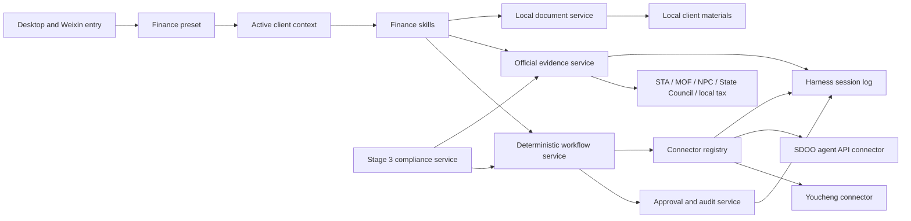

# Agent Note: Xiaojing finance and tax capability roadmap

Status: proposed

English | [中文](2026-08-25-xiaojing-finance-tax-capability-roadmap.zh.md)

## Problem

Xiaojing already provides the DeepSeek Harness standard preset, file and image input, a Weixin channel, Edge and Windows control, usage accounting, and a desktop companion. These general capabilities do not yet form verifiable professional finance and tax workflows. Adding “you are an accountant” to a system prompt cannot enforce regulatory evidence, client isolation, calculation traces, software operations, approvals, or audit records, and cannot support reliable Youcheng or SDOO business loops.

The product serves Chinese mainland SME finance and tax practices. One practitioner may serve multiple general VAT and small-scale taxpayer clients on one Windows computer. Every conclusion and operation must use the correct client, jurisdiction, tax period, accounting standard, and software ledger. Selecting the wrong client, applying an expired rule, or submitting twice creates material business risk.

There is no commercially cleared local full-text regulatory library. Youcheng's public product site links to [developer documentation](https://yiqbopenapi.superboss.cc/), but a real test tenant must establish which editions, credentials, operations, and reliability guarantees are available. SDOO is the company's Odoo-based finance and tax compliance foundation, but this repository has no stable SDOO Agent API. Generic browser automation is also insufficient by itself to prove a finance workflow is closed.

Development must stay within DeepSeek Harness's Cordis plugin architecture. Finance behavior does not belong in `agent-loop`, shared UI implementations, or one growing system prompt. A demonstration may not bypass user-data, approval, and in-place desktop upgrade contracts.

## Proposal

Build Xiaojing as a cross-software, executable, and auditable professional finance and tax workbench in four product stages: the professional foundation; Youcheng and SDOO business-system loops; compliance review and risk discovery; and proactive finance management. Stage 2 completes Youcheng before SDOO. Professional compliance belongs to Stage 3 and must not be represented by unverified heuristics during connector development.

Finance mode is a fifth system Agent preset and a strict capability superset of standard mode. It retains standard mode's files, shell, web, Skills, Plan, Goal, subagents, workflows, Weixin, browser, and computer control, then adds client context, official evidence, finance documents, explainable trial calculations, finance Skills, and connectors. It neither copies Agent Loop nor changes another preset's behavior.

Independent Cordis packages own all finance capabilities. A business Skill defines the professional outcome, required materials, judgment sequence, and deliverable. A deterministic workflow owns progress, retry, idempotency, and approval state. A connector maps stable domain operations to Youcheng or SDOO. Skills do not contain CSS selectors, screen coordinates, API tokens, or vendor-private fields.

### Product boundary

Xiaojing is not a new general ledger and does not replace an accountant's final filing, payment, or audit opinion in Stage 1. It understands natural language, organizes client materials, retrieves official evidence, performs reviewable calculations, orchestrates workflows, operates external systems after authorization, and leaves traceable records. Source documents, official ledgers, approval results, and filing states remain in their owning business systems.

SDOO is the long-term digital finance foundation and system of record. Xiaojing is its natural-language interaction, professional judgment, and task-orchestration layer. SDOO is not another browser-automation target, and the model does not receive arbitrary Odoo ORM, SQL, administrator methods, or unrestricted RPC.

### Target users and initial scope

- Users: finance and tax service firms, bookkeeping practices, and enterprise finance practitioners.
- Clients: one local user manages multiple Chinese mainland SMEs.
- Tax registrations: general VAT taxpayers and small-scale taxpayers.
- Deployment: one-person Windows desktop first; cloud team collaboration is outside this proposal.
- Data: client source files and indexes stay local by default; only the minimum task content is sent to DeepSeek.
- High-impact boundary: submit, approve, reject, delete, post, close, pay, transfer, and file actions use deterministic policy; deletion always requires confirmation.

## Capability architecture

### Package ownership

| Owner | Responsibility | Does not own |
|---|---|---|
| `xiaojing-finance-domain` | Client identity, finance service definitions, operation and audit types | Website scraping, React, or vendor fields |
| `xiaojing-finance-evidence` | Official source registry, retrieval, authority and applicability metadata, bounded cache | Final professional judgment or private client policy |
| `xiaojing-finance-documents` | Local extraction, normalized document facts, and provenance | External-system submission |
| `xiaojing-finance-workflows` | Finance Skills, deterministic workflow definitions, and resumable state | Browser selectors or raw Odoo calls |
| `xiaojing-finance-youcheng` | Youcheng capability discovery, API/DOM adapters, and vendor compatibility | General browser automation or professional rule interpretation |
| `xiaojing-finance-sdoo` | Typed SDOO domain API client and compatibility adapter | Arbitrary ORM, SQL, or UI automation |
| `xiaojing-finance-compliance` | Stage 3 rule packs, findings, remediation, and compliance policy | Connector transport implementation |
| `ui-xiaojing-finance` | Client selector, evidence, workflow progress, and future risk views | Credentials, raw local paths, or business mutation |

These are target owners, not a requirement to create empty packages before a first consumer exists. A package starts with its first complete Service Definition / Provider / Consumer seam, not to reserve a name.

### Stable service contracts

`FinanceClientContext` identifies the client, legal entity, tax registration, accounting standard, industry, jurisdiction, active tax and accounting periods, ledger, and external-system mappings. Client-specific queries and mutations fail before model execution when the context is absent or ambiguous. General educational questions may run without a client but state that no client facts were applied.

`FinanceEvidenceService` accepts a question, jurisdiction, effective date, and source policy, then returns evidence with issuing authority, document number, legal-effect class, publication/effective/expiry dates, geographic scope, source URL, retrieval time, content hash, excerpt provenance, and rights state. Unknown reuse rights fail closed: the service may retain metadata and a short task-bound excerpt but does not silently create a reusable commercial full-text corpus.

`FinanceDocumentService` imports local PDF, image, spreadsheet, Word, and text files, records extraction method and page or cell provenance, and returns normalized facts. It never presents OCR or model inference as source text. Unsupported scans remain “not extracted” until an approved OCR provider exists.

`FinanceWorkflowService` starts, resumes, cancels, and inspects versioned workflows. Each workflow carries client ID, business object, current step, required evidence, completed actions, pending approval, idempotency key, and connector revision. A model may select a workflow and provide business inputs but cannot skip required steps.

`FinanceConnector` exposes typed business operations with `read`, `draft`, `validate`, and `commit` semantics. Every mutation accepts a client/company/ledger scope, expected object revision, idempotency key, and approval proof. A result includes pre-state, post-state, external object ID, audit reference, and explicit business outcome; transport success is not sufficient.

`FinanceAuditService` appends sanitized business events sufficient to reconstruct the client, evidence version, workflow version, user confirmation, and external object used. Credentials, full invoice images, and unnecessary personal data do not enter browser snapshots or ordinary logs.

### Public evidence policy

Authoritative evidence begins with the [National Database of Laws and Regulations](https://flk.npc.gov.cn/search), the [State Taxation Administration policy database](https://fgk.chinatax.gov.cn/zcfgk/index.html), the [Ministry of Finance Accounting Standards for Business Enterprises](https://kjs.mof.gov.cn/zt/kjzzss/kuaijizhunzeshishi/) and interpretations, the State Council, and the applicable local tax authority. Search results, media articles, model memory, and unofficial summaries can discover a source but cannot independently support the conclusion.

Evidence is classified separately by authority, lifecycle, and relevance. The minimum lifecycle states are `future`, `current`, `historical`, `repealed`, and `draft`; a historical-period question applies the rule effective in that period rather than the newest page. Local guidance applies only within its jurisdiction. Enterprise policy and chart-of-account rules are private client evidence and never become public-law authority.

Each professional answer carries the conclusion, client and period assumptions, calculation or judgment trace, official evidence list, unresolved uncertainty, and recommended next action. When an official source is unavailable or applicability cannot be established, the answer marks the point as unverified and does not convert model memory into a citation.

## Stage 0: engineering prerequisites

Stage 0 adds no finance feature. It prevents later stages from increasing coupling. Finance packages join only the Xiaojing composition and use existing slots, tool registry, events, Remote/RPC, and preset roster. Product rows should converge into the proposed `xiaojing-app` bundle before the first finance release when that can be done with no observable behavior change; otherwise finance rows remain in a clearly delimited Xiaojing block protected by a product-layer invariant and a scheduled extraction task.

The finance preset keeps a readable composition synchronized with the shipped `standard` preset and replaces only its product-owned persona. A repository check parses both files, compares all non-persona capability rows and rejects drift. Future finance-only services remain product-owned Cordis rows outside the copied Standard capability set; developers do not maintain an unverified copy by hand.

Stage 0 completes when the official Client profile contains no finance UI, disabling the finance Host and Client rows removes the feature without affecting existing Xiaojing capabilities, and all durable roots are in the desktop user-data contract before any finance file is written.

## Stage 1: professional finance and tax foundation

### Goal

Deliver a selectable finance preset that answers professional Chinese finance and tax questions with official evidence, maintains isolated local client context, extracts common client documents, performs explainable trial calculations, and produces reusable professional work products without submitting to an external business system.

### Deliverables

1. **Finance preset.** The fifth system preset retains every standard capability and adds finance prompt sections, Skill discovery, and finance services. Existing sessions and user-selected defaults stay unchanged during development; making finance the new-install default is a separate release decision after acceptance.
2. **Local client portfolio.** Users create, edit, archive, and select clients with tax type, accounting standard, industry, jurisdiction, periods, chart mapping, and policy attachments. Exactly one active client scopes client-specific work.
3. **Official evidence retrieval.** The product searches configured official sources, records authority and effective dates, retains only bounded audit evidence, and visibly distinguishes current, historical, local, and unverified material.
4. **Document workspace.** The product extracts structured facts from text PDFs, spreadsheets, Word files, and supported images while preserving page or cell provenance and extraction confidence. Scanned-PDF OCR is not promised until a separate OCR decision is approved.
5. **Explainable trial calculations.** Initial calculators cover VAT status-sensitive examples, VAT-derived surcharges, corporate-income-tax pre-calculation scenarios, and basic payroll/personal-income-tax examples only with sufficient inputs and official rules. Every result shows formula, inputs, rounding, and rule version and is labeled as a trial calculation rather than a filing result.
6. **Professional outputs.** Research memo, client question list, document checklist, calculation worksheet, accounting-treatment memo, and follow-up actions use stable templates and can be saved in the client workspace.
7. **Initial Skill pack.** `finance-tax-research-cn`, `finance-invoice-review`, `finance-voucher-draft`, `finance-data-analysis`, and `finance-reimbursement` own task instructions and outputs. Stage 1 disables external-system mutation.

### Stage 1 release criteria

- A keyless assembled snapshot proves finance exposes every standard tool plus finance additions and does not alter another preset.
- The same request under two clients never shares private facts, cached work products, or connector IDs.
- A dated tax case proves current, historical, and local-source handling and refuses a conclusion when applicability remains unresolved.
- Every extracted fact points to a file hash and page, table, or cell; unsupported inputs stay explicit instead of receiving invented content.
- Calculation fixtures cover general and small-scale taxpayer contexts, period boundaries, missing inputs, and rounding; outputs reproduce without the model.
- Brand, usage, upload, vision, Weixin, Edge, Windows control, Visualize, desktop companion, and user-data regressions pass.

## Stage 2.1: Youcheng reimbursement closed loop

### Goal

Deliver a stable, resumable, and auditable Youcheng workflow that inspects reimbursement records, prepares finance-review decisions, obtains human confirmation, and commits an approved action exactly once without screenshots or coordinate clicks.

### Technical route

The first task is an API qualification spike against a dedicated Youcheng test tenant. The official product site links to OPENAPI documentation, so the connector prefers an authenticated official API when it exposes the required object and mutation. The spike records authentication, scopes, tenant isolation, sandbox availability, pagination, rate limits, idempotency, webhooks, error semantics, and licensing. Production does not use an undocumented endpoint.

When an operation is unavailable through an approved API, a Youcheng-specific DOM adapter may use the existing Edge transport while owning its page recognition, semantic locators, state assertions, and version compatibility. Generic `browser_control` remains transport infrastructure, not the business process. Coordinates, screenshots, and Windows UIA are not accepted as the normal path.

The first vertical slice is finance review because the initial user is a finance practitioner. It lists pending reimbursements, opens one record and its attachments, extracts review facts, presents a proposed approve/reject/request-more-information decision, asks for confirmation, commits once, and verifies the resulting state. Employee draft creation and submission is the second slice; payment and bank transfer remain excluded.

### Workflow rules

- Read and export operations require no approval.
- Creating or editing an identified draft may proceed but cannot submit it.
- Submit, approve, reject, and withdraw require one confirmation showing client, document, amount, action, and consequence.
- Delete always requires a separate confirmation even under a never-approve session policy.
- Each commit uses an idempotency key and reads the object after mutation. A timeout with unknown outcome stops for reconciliation instead of retrying blindly.
- Workflow state stores the step and external revision so restart, Weixin recovery, or model retry cannot duplicate an action.
- A page, API, or permission version mismatch disables mutation and returns a compatibility error; it never guesses a selector or field.

### Stage 2.1 release criteria

- API and DOM providers pass the same connector contract suite; missing operations fail explicitly.
- A real test tenant completes 100 repeated reads and at least 30 end-to-end reviews with no duplicate action, wrong client, wrong record, or hidden fallback.
- Tests cover expired login, permission denial, slow loading, redesign, stale revision, connection loss, restart, expired confirmation, and unknown commit outcome.
- Stage 1 professional analysis feeds the review workflow while the workflow remains deterministic after final confirmation.
- The product does not claim a Youcheng closed loop until the real-tenant acceptance record is approved.

## Stage 2.2: SDOO and Odoo accounting integration

### Goal

Make SDOO the primary digital finance foundation and enable Xiaojing to query and perform most daily accounting operations through a stable, versioned, domain-specific API with draft/validate/commit separation, role permissions, and complete auditability.

### SDOO Agent API

SDOO provides `/sdoo/agent/v1` or an equivalent versioned module owned by the SDOO team. Xiaojing does not bind workflows directly to arbitrary Odoo models. The API presents client, company, ledger, account, period, voucher, invoice, receivable, payable, payment, bank transaction, reconciliation, report, and close-check operations. Each endpoint defines roles, company and ledger scope, dry-run or draft behavior, validation messages, idempotency, optimistic concurrency, and audit reference.

Odoo 19 introduces JSON-2 and deprecates the legacy `/xmlrpc`, `/xmlrpc/2`, and `/jsonrpc` external APIs for removal in later releases. SDOO may use the correct internal Odoo mechanism for its deployed version, but the Xiaojing connector depends only on the SDOO domain API, so an Odoo upgrade changes the SDOO adapter instead of every finance Skill.

### Delivery sequence

1. **Identity and read model.** Company, ledger, period, chart of accounts, partners, balances, entries, and report queries.
2. **Voucher lifecycle.** Generate a voucher draft from structured evidence, validate accounts and dimensions, present impact, confirm, post, and verify.
3. **Invoice and receivable/payable lifecycle.** Query invoices, create draft business records, match partners and open items, and expose aging and exceptions.
4. **Bank and reconciliation.** Import or query transactions, propose matches, require confirmation for write-off or posting, and verify reconciliation.
5. **Reports and close.** Trial balance, ledgers, statements, tax-support schedules, and close checks; formal close stays confirmed and is reversible only according to SDOO policy.

### Stage 2.2 release criteria

- Generated SDOO API schemas are the connector source of truth, and incompatible servers fail the connection health check.
- Every mutation provides dry-run or draft, idempotency, expected revision, human confirmation, post-read verification, and audit ID.
- Client/company/ledger mismatches are rejected by both Xiaojing and SDOO; the model cannot override the server check.
- Contract tests run against a fake server and supported SDOO versions; real acceptance uses disposable ledgers and reconciliation fixtures.
- Credentials, arbitrary model names, SQL, unrestricted domain filters, and administrator methods do not reach the model or browser Client.

## Stage 3: compliance review and risk discovery

### Goal

Detect, explain, and help remediate material reimbursement, invoice, accounting, tax, and internal-control risks using dated official evidence, deterministic controls, and client context without presenting unverified model judgment as a legal conclusion.

Stage 2 reserves a pre-execution compliance hook but implements no professional compliance rules. Stage 3 adds `xiaojing-finance-compliance`, versioned rule packs, and the `RiskFinding` lifecycle. Hard controls expressible from structured SDOO data live in SDOO; Xiaojing adds cross-document reasoning, official research, explanation, orchestration, and remediation assistance.

`RiskFinding` records client, business object, category, severity, amount at risk, rule version, evidence, official authority, period, confidence, blocking state, recommended action, reviewer, and disposition. It distinguishes deterministic rule failure, documentary inconsistency, anomaly, and professional-review suggestion. Only deterministic blocking policy may automatically prevent a commit; probabilistic findings require review.

Delivery begins with reimbursement and invoice risks because Stage 2.1 supplies stable objects and evidence: duplicate invoice, inconsistent entity, amount/tax mismatch, missing required material, policy limit, suspicious split, stale invoice, and approval-chain exception. It then covers voucher/account mapping, cutoff, revenue/cost matching, tax treatment, and SDOO cross-ledger controls.

Stage 3 completes when a finding reproduces from stored inputs and rule versions, every legal claim links to applicable official evidence, false positives can be explained and dispositioned, remediation can reopen the correct Stage 2 workflow, and an audit-ready review exports without unrelated client data.

## Stage 4: proactive finance management

### Goal

Turn verified data and workflows into proactive close assistance, deadline management, exception monitoring, and management insight for one practitioner's local client portfolio.

The first functions are period-close checklist, missing-document reminders, unreconciled bank items, aging exceptions, filing and payment deadlines, abnormal account movement, and unfinished-workflow follow-up. Alerts derive from dated client facts and are deduplicated; they are not generic model reminders. Cross-client views show minimum portfolio metadata and require an explicit client switch before detail or action.

Stage 4 does not add autonomous payment, tax filing, cross-client data pooling, or cloud team collaboration. Each requires a separate security, legal, and deployment decision.

## GPT-executable development task catalog

Each item is a bounded development unit. The sentence after **Goal** can be copied directly into a GPT/Codex goal. A task completes only when its deliverables and verification pass; written code alone is not completion. Tasks run in order inside a stage unless their dependencies permit parallel work.

### F0-1 — Finance extension foundation

**Goal:** Establish the Xiaojing finance extension boundary without changing user-visible behavior: define product-owned package locations, composition rows, durable data roots, feature manifest, compatibility adapter rules, and product-layer checks so every later finance capability can be enabled or removed without editing Agent Loop or official UI implementations.

Scope: architecture alignment, Xiaojing composition ownership, persistent-path contract, empty-free package policy, and isolation tests. Do not implement tax answers, client UI, or connectors. Complete when an assembled Xiaojing build enables a minimal probe and an official build contains no finance code or UI registration.

### F1-1 — Finance preset strict superset

**Goal:** Add a product-owned finance system preset that preserves every non-persona capability of the shipped standard preset, adds finance-specific prompt sections and Skill access, appears as the fifth selectable mode, and cannot drift from standard unnoticed.

Scope: preset metadata, generated composition or checked synchronization, mount validation, selection snapshot, and existing-session preservation. Do not change standard behavior or force an existing user's default. Complete when a structural test proves all standard capability rows remain equivalent and a real finance session exposes the expected catalog.

### F1-2 — Local multi-client context

**Goal:** Implement a local finance client registry and active-client context that isolates client metadata, periods, tax status, accounting standard, policies, chart mappings, and external-system references, and rejects any client-specific task when client identity is absent or ambiguous.

Scope: versioned storage, atomic writes, Host service, browser-safe Remote, settings UI, archive instead of destructive delete, and upgrade protection. Do not store API credentials in client JSON. Complete when two-client isolation, restart recovery, malformed-data refusal, and desktop-upgrade fixtures pass.

### F1-3 — Official evidence service

**Goal:** Implement a date-aware and authority-aware Chinese finance-tax evidence service that retrieves only configured official sources, records applicability and provenance, uses a bounded rights-aware cache, and returns an unverified state instead of inventing authority when evidence is unavailable.

Scope: source registry, query planning, fetch/parser adapters, authority and lifecycle fields, hashes, jurisdiction rules, and evidence rendering. Do not build a bulk full-text corpus or treat search snippets as final evidence. Complete when fixtures prove current, historical, future, repealed, draft, and local guidance behavior.

### F1-4 — Finance document normalization

**Goal:** Implement local ingestion and normalized fact extraction for supported PDF, image, spreadsheet, Word, and text client materials, preserving file hash and page/cell provenance and explicitly marking unsupported or uncertain extraction.

Scope: safe parsers, size/type limits, untrusted-content handling, normalized tables, and local persistence. Reuse rc.2 attachments and file uploads instead of adding another upload button. Do not claim scanned-PDF OCR without an approved provider. Complete when mixed-file, malicious-file, restart, and provenance tests pass.

### F1-5 — Trial calculations and finance Skill pack

**Goal:** Deliver deterministic, explainable trial-calculation services and the first five finance Skills so finance-mode answers produce official evidence, client assumptions, calculation traces, and reusable professional outputs while performing no external-system mutation.

Scope: calculator versioning, rounding, missing-input diagnostics, output templates, and Skill registration. Keep formulas outside free-form prompts when deterministic computation is possible. Complete when keyless snapshots and numeric fixtures reproduce results for general and small-scale taxpayer examples.

### F1-6 — Stage 1 integrated acceptance

**Goal:** Validate the complete Stage 1 finance mode against a sanitized multi-client fixture and real official-source manual cases, close all product isolation, privacy, evidence, calculation, and upgrade failures, and produce a preview that can be accepted without enabling any business-system write operation.

Scope: assembled snapshots, focused tests, user-data copy, Electron preview, and acceptance record. Do not package or announce Stage 1 with an unresolved release criterion.

### F2Y-1 — Youcheng API qualification

**Goal:** Determine with a dedicated Youcheng test tenant which official OPENAPI operations can support the reimbursement workflows, document authentication, scopes, licensing, idempotency, and error semantics, and produce a connector capability matrix with unsupported operations explicitly identified.

Scope: read-only spike first, secret handling, and official documentation references. Do not use undocumented endpoints or production customer data. Complete when recorded tests support the matrix and select API, DOM, or unsupported for every required operation.

### F2Y-2 — Youcheng connector read model

**Goal:** Implement a typed Youcheng connector that discovers the current tenant, lists and reads reimbursement objects and attachments, normalizes them into finance-domain records, and returns stable compatibility errors instead of exposing vendor API or DOM details.

Scope: API provider plus a Youcheng-specific DOM provider only where required, connector contract tests, pagination, login expiry, and version detection. Do not mutate Youcheng. Complete when both providers satisfy the read contract and repeated reads select the correct tenant and record.

### F2Y-3 — Youcheng finance-review closed loop

**Goal:** Implement a resumable finance-review workflow that reads one pending reimbursement, gathers its evidence, prepares a review recommendation, obtains explicit user confirmation, approves, rejects, or requests information exactly once, and verifies the resulting Youcheng state.

Scope: `finance-reimbursement` Skill, workflow state, approval summary, idempotency, post-read, and recovery. Exclude payment and deletion. Complete after repeated real-tenant acceptance meets the Stage 2.1 threshold.

### F2Y-4 — Youcheng reimbursement draft and submit

**Goal:** Implement a second resumable workflow that creates or updates a reimbursement draft from user-provided materials, validates every required field, shows a complete submission preview, submits only after confirmation, and reconciles an unknown result without duplicate submission.

Scope: draft mapping, attachments, policy validation, confirmation, and restart recovery. Do not auto-select missing business facts. Complete when partial drafts, validation rejection, timeout, and retry cases preserve one external document.

### F2Y-5 — Youcheng release certification

**Goal:** Certify the Youcheng connector and workflows as a production-supported closed loop by running contract, fault-injection, repeated real-tenant, and cross-feature regression suites, documenting the supported Youcheng version, and disabling mutation on compatibility mismatch.

Scope: reliability evidence and release documentation. Do not reduce thresholds to pass a flaky provider.

### F2S-1 — SDOO Agent API contract

**Goal:** Define and implement the versioned SDOO Agent API foundation with scoped identity, roles, typed domain operations, dry-run/draft/commit semantics, optimistic concurrency, idempotency, and audit references without exposing arbitrary Odoo ORM or administrator access.

Scope: SDOO module contract, generated schemas, authentication, health/version endpoint, and fake server. Xiaojing and SDOO teams approve one contract before business operations begin.

### F2S-2 — SDOO accounting read path

**Goal:** Connect Xiaojing to the SDOO Agent API for company, ledger, period, account, partner, balance, journal-entry, and report queries with strict client scope and browser-safe results.

Scope: connector compatibility adapter, credential service, health checks, pagination, and read Skills. Complete when fake and disposable real-ledger tests return equivalent normalized records and reject cross-company access.

### F2S-3 — SDOO voucher, invoice, and open-item workflows

**Goal:** Implement draft-first, validated, and auditable SDOO workflows for voucher creation/posting, invoice, and receivable/payable operations, each with deterministic pre-checks, impact preview, explicit confirmation, idempotent commit, and post-read verification.

Scope: typed workflows and professional output; no model-to-ORM bridge. Complete when duplicate, stale-revision, missing-dimension, permission-denial, and restart cases remain safe.

### F2S-4 — SDOO reconciliation, reports, and close

**Goal:** Implement bank matching proposals, confirmed reconciliation, finance reports, and period-close checks through SDOO, preserving reversible drafts where supported and requiring explicit confirmation for write-off, posting, and close operations.

Scope: bank and reconciliation, statements, schedules, and close checklist. Payment execution and tax filing stay excluded unless separately approved.

### F2S-5 — SDOO integration certification

**Goal:** Validate that the supported SDOO version matrix, domain API, Xiaojing connector, and Stage 1 professional services form a stable accounting-operation loop that preserves data, permissions, and audit history across application and SDOO upgrades.

Scope: contract compatibility, migration fixtures, disposable ledgers, failure recovery, and product regressions. Complete only when no workflow relies on Odoo UI structure or arbitrary RPC.

### F3-1 — Compliance finding foundation

**Goal:** Implement the versioned compliance rule and `RiskFinding` services, pre-execution compliance hook, severity and blocking policy, evidence linkage, reviewer disposition, and audit lifecycle without allowing an unreviewed probabilistic finding to block a transaction.

Scope: deterministic rule interface, finding persistence, sensitive-data projection, and SDOO enforcement contract. Do not add a rule without owner, evidence, and fixtures.

### F3-2 — Reimbursement and invoice risk pack

**Goal:** Deliver the first production risk pack for duplicate, entity, amount/tax, required-material, policy-limit, split, date, and approval-chain risks using Youcheng or SDOO structured objects and official evidence where applicable.

Scope: rule fixtures, explanations, false-positive disposition, and remediation links. Complete when every finding reproduces from stored inputs and rule versions.

### F3-3 — Accounting and tax risk pack

**Goal:** Extend compliance review to voucher mapping, cutoff, revenue/cost matching, tax treatment, account movement, and cross-ledger consistency while separating deterministic violations from professional-review suggestions.

Scope: SDOO structured data and dated official sources. Do not provide a formal audit opinion or autonomous filing decision.

### F3-4 — Compliance center and remediation

**Goal:** Add a client-scoped compliance center that explains findings, links evidence, records reviewer decisions, launches the correct remediation workflow, and exports an audit-ready review record without exposing another client's data.

Scope: Client UI and workflow links; every mutation continues through Stage 2 connectors and approvals.

### F4-1 — Proactive close and deadline assistant

**Goal:** Implement deduplicated, evidence-based period-close checklists, missing-material reminders, unreconciled-item follow-up, and filing/payment deadline tracking for the active client with explicit source dates and completion state.

Scope: local scheduling, SDOO/Youcheng read data, and user-confirmed completion. Do not autonomously file or pay.

### F4-2 — Local portfolio insight

**Goal:** Implement a privacy-preserving local portfolio view that surfaces client-level exceptions, aging, unfinished workflows, and material movements while requiring an explicit client switch before revealing details or executing an action.

Scope: one practitioner's local client set. Cloud collaboration and pooled model training are excluded.

## Development session protocol

When a new GPT/Codex session receives one Goal, it first reads this note, the [Xiaojing product baseline](../../../../docs/xiaojing-product-development.md), the [module architecture](../../../../docs/xiaojing-module-architecture.md), owning package READMEs, and repository instructions. It inspects current code before proposing paths, preserves unrelated worktree changes, and refuses a later task whose prerequisites are incomplete.

Each implementation plan restates observable success criteria; packages and extension points; public types and Remote/event changes; durable schema and migration; sensitive-data handling; approval and idempotency; unit, integration, keyless snapshot, and manual acceptance; documentation and Agent Note changes; and rollback or plugin removal. An undecided item means the task is not ready for implementation.

Each task runs focused checks before broader checks. User-visible behavior requires an assembled keyless snapshot. Connector mutation requires fake-provider fault tests and real disposable-tenant acceptance. A desktop release also requires the current user-data upgrade fixture and in-place installation test from the preceding formal version.

## Alternatives considered

**Put every finance behavior in one system prompt.** Rejected because prompts cannot enforce client scope, deterministic calculation, approval, idempotency, durable progress, or connector compatibility and are difficult to test and remove.

**Build a local full-text regulation library first.** Rejected at this stage because completeness, effective-date coverage, and commercial reuse rights are not established. Official retrieval with an auditable bounded cache is safer; a full corpus requires a separate source-rights project.

**Use generic browser automation for every finance system.** Rejected because a generic page tool cannot promise stable domain objects, exactly-once mutation, or vendor-version compatibility. It remains transport for a vendor-specific adapter when an approved API is unavailable.

**Require a Youcheng API before any integration.** Rejected because the public site exposes documentation while actual tenant capabilities are unknown, and a stable vendor-specific DOM adapter may cover missing operations. One connector contract accommodates both without coupling workflows.

**Expose generic Odoo ORM or RPC directly to the model.** Rejected because it grants excessive authority, couples Skills to Odoo internals, and weakens invariants, upgrade compatibility, and auditing. SDOO exposes versioned domain operations.

**Implement compliance rules during the software-loop stage.** Rejected because it mixes connector stabilization with professional policy and encourages unverified warnings. Stage 2 keeps universal operation safety and a future hook; Stage 3 owns compliance.

**Create every target package immediately.** Rejected because empty abstractions add maintenance without a complete capability seam. A package starts with a real consumer and tests.

## Acceptance criteria

- Roadmap order remains foundation, Youcheng, SDOO, compliance, and proactive management; a later stage cannot absorb unfinished earlier work silently.
- Finance mode is a mechanically checked strict capability superset of standard and does not alter existing preset behavior or running sessions.
- Client-specific work is impossible without an unambiguous active client, and private facts do not cross clients.
- Professional claims are date-, jurisdiction-, and authority-aware and retain official provenance; missing evidence produces an explicit unverified state.
- Deterministic calculations and workflows reproduce without hidden model reasoning.
- Youcheng and SDOO mutations use typed connector operations, approval, idempotency, durable progress, and post-read verification.
- SDOO integration uses a versioned domain API rather than arbitrary ORM, SQL, generic RPC, or browser automation.
- Stage 3 findings are versioned, explainable, reviewable, and linked to remediation; probabilistic findings cannot silently block or mutate.
- Every feature is removable through Xiaojing composition rows and package dependencies, with no Agent Loop or product-specific official-UI implementation.
- Desktop upgrades preserve sessions, client data, credentials, Skills, workflow state, audit records, attachments, and existing Xiaojing features; a failed migration blocks release.

## Risks

**Regulatory freshness and rights.** Official sites can change layout or terms, and retrieval does not prove a complete corpus. Source adapters need health checks, rights state, and visible coverage gaps; inaccessible evidence stops authoritative output.

**Vendor API uncertainty.** Youcheng OPENAPI access may depend on edition, contract, or tenant permission. Qualification may conclude an operation is unsupported; that result must not become an undocumented integration.

**Browser fragility.** A vendor DOM adapter still depends on page semantics and may break after redesign. Version recognition and fail-closed mutation are mandatory, and the product cannot advertise a closed loop before repeated real-tenant testing.

**Preset drift.** The preset system stores full compositions. Without generation or structural comparison, finance will eventually miss a new standard capability. The drift check blocks Stage 1 release.

**Client-context mistakes.** Natural-language client names can be ambiguous. Mutations use immutable IDs and confirmation summaries; model inference never selects a ledger by itself.

**Over-automation.** A technically successful operation can still be professionally wrong. Draft, validation, preview, confirmation, and post-read remain separate, while payment, transfer, and filing stay outside initial scope.

**SDOO contract expansion.** A generic call-any-model shortcut erodes domain boundaries. New operations need explicit schemas, roles, invariants, and fixtures before exposure.

**Scope growth.** This is a multi-stage roadmap. Each GPT goal is deliberately bounded; combining goals in one implementation session raises regression risk and requires a new reviewed plan.
