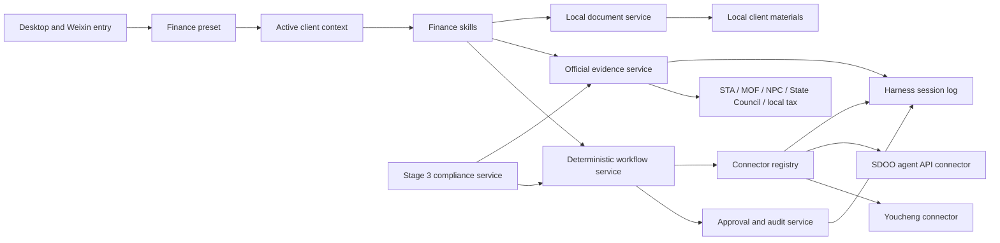

# Agent Note: Xiaojing finance and tax capability roadmap

Status: proposed

[English](2026-08-25-xiaojing-finance-tax-capability-roadmap.md) | 中文

## Problem

小兢会计已经具备 DeepSeek Harness 标准模式、文件与图片输入、微信频道、Edge 和 Windows 操控、用量统计及桌面状态提示，但这些通用能力尚未形成可验证的财税专业工作流。仅在系统提示中加入“你是一名会计”无法保证法规依据、客户隔离、计算过程、软件操作、审批控制和审计记录，也无法支撑有成报销及 SDOO 的稳定业务闭环。

产品面对中国大陆中小企业财税服务场景。一个从业人员会在同一台 Windows 电脑上服务多个一般纳税人或小规模纳税人客户；任何结论和操作都必须绑定正确客户、地区、税款所属期、会计制度和软件账套。错误客户、过期政策或重复提交都会造成实质业务风险。

当前没有可商用的本地法规全文库。有成报销的公开产品页提供[开发文档入口](https://yiqbopenapi.superboss.cc/)，但租户是否开放、认证方式、可调用业务和稳定性仍需使用真实测试租户确认。SDOO 是基于 Odoo 的自研财税合规数字化底座，尚未在本仓库提供稳定的 Agent API。通用浏览器自动化目前也不足以单独证明财务流程闭环。

开发必须在 DeepSeek Harness 的 Cordis 插件架构内完成，不能把财务逻辑写入 `agent-loop`，不能让产品扩展继续堆入共享 UI 或单个巨大提示词，也不能为了短期演示绕过用户数据、审批和覆盖升级规则。

## Proposal

把小兢会计建设为“跨软件、可执行、可审计的专业财税作业工作台”，按四个产品阶段交付：财税专业基础；有成报销及 SDOO 软件业务闭环；合规审阅与风险发现；主动财务管理。第二阶段先完成有成报销，再接入 SDOO；第三阶段才引入专业合规引擎，不能提前把启发式提示包装成合规结论。

财税模式是第五个系统 Agent preset，是标准模式的严格能力超集。它保留标准模式的文件、Shell、网页、Skill、Plan、Goal、子代理、工作流、微信、浏览器和电脑操控能力，再增加客户上下文、官方证据、财税文档、可解释试算、财务业务 Skill 及连接器。财税模式不复制一套 Agent Loop，也不改变其他 preset 的行为。

所有财务能力通过独立 Cordis 包装配。业务 Skill 描述专业目标、材料要求、判断步骤和交付格式；确定性 workflow 保存进度、重试、幂等和审批状态；connector 把稳定的领域动作映射到有成或 SDOO。Skill 不能保存 CSS selector、屏幕坐标、API Token 或供应商私有字段。

### 产品边界

小兢会计不是新的总账系统，也不在第一阶段代替会计人员作出最终申报、支付或审计意见。它负责理解自然语言、组织客户材料、查询官方依据、完成可复核计算、编排业务流程、在获得授权后操作外部系统，并留下可追溯记录。源单据、正式账簿、审批结果和申报状态仍由对应业务系统保存。

SDOO 是长期的财务数字底座和核心记录系统。小兢会计是 SDOO 的自然语言交互、专业判断和任务编排层。不能把 SDOO 简化成另一个网页自动化目标，也不能向模型暴露任意 Odoo ORM、SQL、管理员方法或未约束的 RPC。

### 目标用户与首发范围

- 用户：财税服务机构、代账机构和企业财务从业人员。
- 客户：一个本机用户管理多个中国大陆中小企业客户。
- 税务身份：一般纳税人和小规模纳税人。
- 部署：先支持单人 Windows 桌面端；不在本方案内建设云端团队协作。
- 数据策略：客户原始文件和索引优先留在本机；只向 DeepSeek 发送完成当前任务所需的最小内容。
- 高影响边界：正式提交、审批、驳回、删除、记账、结账、付款、转账和申报必须由确定性策略控制；删除始终二次确认。

## Capability architecture

### Package ownership

| Owner | Responsibility | Does not own |
|---|---|---|
| `xiaojing-finance-domain` | Client identity, finance service definitions, operation and audit types | Website scraping, React, vendor fields |
| `xiaojing-finance-evidence` | Official source registry, retrieval, authority and applicability metadata, bounded cache | Final professional judgment or client private policy |
| `xiaojing-finance-documents` | Local extraction, normalized document facts and provenance | External-system submission |
| `xiaojing-finance-workflows` | Finance Skills, deterministic workflow definitions and resumable state | Browser selectors or raw Odoo calls |
| `xiaojing-finance-youcheng` | Youcheng capability discovery, API/DOM adapters and vendor compatibility | General browser automation or professional rule interpretation |
| `xiaojing-finance-sdoo` | Typed SDOO domain API client and compatibility adapter | Arbitrary ORM, SQL or UI automation |
| `xiaojing-finance-compliance` | Stage 3 rule packs, findings, remediation and compliance policy | Connector transport implementation |
| `ui-xiaojing-finance` | Client selector, evidence, workflow progress and future risk views | Credentials, raw local paths or business mutation |

These are target owners, not a requirement to create empty packages before their first consumer exists. A package is created with its first complete Service Definition / Provider / Consumer seam; it is not created merely to reserve a name.

### Stable service contracts

`FinanceClientContext` identifies the client, legal entity, tax registration type, accounting standard, industry, region, active tax/accounting period, ledger and external-system mappings. A client-specific query or mutation fails before model execution when this context is absent or ambiguous. General learning questions may run without a client but must state that no client facts were applied.

`FinanceEvidenceService` accepts a question, jurisdiction, effective date and source policy, then returns evidence records with issuing authority, document number, legal-effect class, publication/effective/expiry dates, geographic scope, source URL, retrieval time, content hash, excerpt provenance and rights state. Unknown usage rights fail closed: the system may keep metadata and a short task-bound excerpt but cannot silently build a reusable commercial full-text corpus.

`FinanceDocumentService` imports local PDF, image, spreadsheet, Word and text files, records the extraction method and page or cell provenance, and returns normalized facts. It never presents OCR or model inference as source text. Unsupported scans remain marked “未提取” until an approved OCR provider exists.

`FinanceWorkflowService` starts, resumes, cancels and inspects versioned workflows. Each workflow carries client ID, business object, current step, required evidence, completed actions, pending approval, idempotency key and connector revision. A model can select a workflow and supply business inputs but cannot skip its required steps.

`FinanceConnector` exposes typed business operations with `read`, `draft`, `validate` and `commit` semantics. Every mutation accepts a client/company/ledger scope, expected object revision, idempotency key and approval proof. Results include the pre-state summary, post-state summary, external object ID, audit reference and an explicit outcome; transport success alone is not business success.

`FinanceAuditService` appends sanitized business events that are sufficient to reconstruct which client, evidence version, workflow version, user confirmation and external object were used. Credentials, full invoice images and unnecessary personal data never enter browser snapshots or ordinary logs.

### Public evidence policy

Authoritative public evidence starts with the [国家法律法规数据库](https://flk.npc.gov.cn/search)、[国家税务总局政策法规库](https://fgk.chinatax.gov.cn/zcfgk/index.html)、[财政部企业会计准则](https://kjs.mof.gov.cn/zt/kjzzss/kuaijizhunzeshishi/)及其准则解释、国务院和属地税务机关。Search results, media articles, model memory and unofficial summaries may help discover a source but cannot independently support a final conclusion.

Evidence is classified separately by authority, lifecycle and relevance. The minimum lifecycle states are `future`、`current`、`historical`、`repealed` and `draft`; a question about a past period uses the rule effective for that period instead of the latest page. Local tax guidance is only applied inside its jurisdiction. Enterprise policy and chart-of-account rules are private client evidence, never promoted to public-law authority.

Each professional answer includes the conclusion, client and period assumptions, calculation or judgment trace, official evidence list, unresolved uncertainty and recommended next action. If an official source cannot be reached or applicability cannot be established, the answer says “待核验” and does not convert model memory into a citation.

## Stage 0: engineering prerequisites

Stage 0 does not add a finance feature. It prevents the next stages from increasing coupling. The finance packages join the Xiaojing-only composition and use the existing slots, tool registry, event system, Remote/RPC and preset roster. Product rows should converge into the proposed `xiaojing-app` bundle before the first finance release if that convergence can be completed without changing observable behavior; otherwise the finance rows must at least be grouped in a clearly delimited Xiaojing block with a product-layer invariant and a scheduled extraction task.

财务预设保留一份与内置 `standard` 预设同步的可读组装，只替换产品自有的人格。仓库检查会解析两份文件，比较全部非人格能力行并拒绝漂移。未来财务专属服务仍以产品自有 Cordis 行位于复制的标准能力集之外；开发者不手工维护未经验证的副本。

Stage 0 is complete when the official Client profile contains no finance UI, disabling the finance Host/Client rows removes the feature without affecting existing Xiaojing capabilities, and all new durable roots are included in the desktop user-data contract before any file is written.

## Stage 1: professional finance and tax foundation

### Goal

Deliver a selectable finance preset that answers professional Chinese finance and tax questions with official evidence, maintains isolated local client context, extracts common client documents, performs explainable trial calculations, and produces reusable professional work products without submitting to any external business system.

### Deliverables

1. **Finance preset.** The fifth system preset retains every standard capability and adds finance prompt sections, Skill discovery and finance services. Existing sessions and user-selected defaults remain unchanged during development; whether a new installation defaults to finance mode is a separate release decision after acceptance.
2. **Local client portfolio.** The user can create, edit, archive and select clients with tax type, accounting standard, industry, region, periods, chart mapping and policy attachments. Exactly one active client is used for a client-specific task.
3. **Official evidence retrieval.** The product searches configured official sources, records authority and effective dates, caches only bounded evidence needed for audit, and visibly distinguishes current, historical, local and unverified material.
4. **Document workspace.** The product extracts structured data from text PDFs, spreadsheets, Word files and supported images, preserving page/cell provenance and extraction confidence. Scanned PDF OCR is not promised until a separate OCR decision is approved.
5. **Explainable trial calculations.** Initial calculators cover VAT status-sensitive examples, additional taxes derived from VAT, enterprise income tax pre-calculation scenarios and basic payroll/personal-income-tax examples only when the required inputs and official rules are available. Every result exposes formula, inputs, rounding and rule version and is labeled trial calculation, not a filing result.
6. **Professional outputs.** Research memo, client question list, document checklist, calculation worksheet, accounting treatment memo and follow-up action list use stable templates and can be saved in the client workspace.
7. **Initial Skill pack.** `finance-tax-research-cn`, `finance-invoice-review`, `finance-voucher-draft`, `finance-data-analysis` and `finance-reimbursement` own task instructions and expected outputs. System mutation remains disabled in Stage 1.

### Stage 1 release criteria

- A keyless assembled snapshot proves the finance preset exposes every standard tool plus the finance additions and does not alter other presets.
- The same question for two client contexts never shares private facts, cached work products or connector IDs.
- A dated tax question demonstrates current, historical and local-source handling and refuses a conclusion when official applicability is unresolved.
- Every extracted fact points to a file hash and page, table or cell location; unsupported documents stay explicit instead of receiving invented content.
- Calculation fixtures cover general and small-scale taxpayer contexts, period boundaries, missing inputs and rounding; outputs are reproducible without the model.
- Existing brand, usage, upload, vision, Weixin, Edge, Windows control, Visualize, desktop companion and user-data tests pass.

## Stage 2.1: Youcheng reimbursement closed loop

### Goal

Deliver a stable, resumable and auditable Youcheng workflow that can inspect reimbursement records, prepare finance review decisions, obtain human confirmation and commit an approved action exactly once, without relying on screenshots or coordinate clicks.

### Technical route

The first task is an API qualification spike against a dedicated Youcheng test tenant. The official product site links to an OPENAPI document, so the connector prefers an authenticated official API when it provides the required object and mutation. The spike records authentication, scopes, tenant isolation, sandbox availability, pagination, rate limits, idempotency, webhooks, error semantics and licensing. An undocumented endpoint is not used in production.

When an operation is unavailable through an approved API, a Youcheng-specific DOM adapter may use the existing Edge transport but owns its own page recognizers, semantic locators, state assertions and version compatibility. The generic `browser_control` remains an infrastructure fallback, not the definition of the business process. Coordinates, screenshots and Windows UIA are not accepted as the normal workflow path.

The first vertical slice is finance review because the initial user is a finance practitioner. It lists pending reimbursements, opens one record and its attachments, extracts review facts, presents a proposed approve/reject/request-more-information decision, asks for confirmation, commits once and verifies the resulting status. Employee draft creation and submission follows as a second vertical slice; payment and bank transfer remain excluded.

### Workflow rules

- Read and export operations do not require approval.
- Creating or editing a draft may proceed inside a clearly identified draft but cannot submit it.
- Submit, approve, reject and withdraw require one confirmation showing client, document, amount, action and consequence.
- Delete always requires a separate confirmation even under “从不审批”.
- Each committed operation uses an idempotency key and reads the object after mutation. A timeout with unknown outcome stops for reconciliation instead of retrying blindly.
- The workflow persists its step and external object revision so application restart, Weixin queue recovery or model retry does not duplicate an action.
- A page, API or permission version mismatch disables mutation and returns a compatibility error; it never guesses a selector or field.

### Stage 2.1 release criteria

- API and DOM providers pass the same connector contract suite; unavailable operations fail explicitly.
- A real test tenant completes 100 repeated read flows and at least 30 end-to-end review flows without duplicate actions, wrong client, wrong record or hidden fallback.
- Tests cover login expiry, permission denial, slow loading, page redesign, stale object revision, lost connection, restart, confirmation expiry and unknown commit outcome.
- The Stage 1 professional analysis can feed the review workflow, while the workflow remains deterministic after the user confirms the final action.
- The product does not claim “有成闭环” until the real-tenant acceptance record is signed off.

## Stage 2.2: SDOO and Odoo accounting integration

### Goal

Make SDOO the primary digital finance foundation and enable Xiaojing to query and perform most daily accounting operations through a stable, versioned, domain-specific API with draft/validate/commit separation, role permissions and complete auditability.

### SDOO Agent API

SDOO provides `/sdoo/agent/v1` or an equivalent versioned module owned by the SDOO team. Xiaojing never binds its business workflows directly to arbitrary Odoo models. The API presents business operations such as client, company, ledger, account, period, voucher, invoice, receivable, payable, payment, bank transaction, reconciliation, report and close check. Each endpoint defines required roles, company and ledger scope, dry-run or draft behavior, validation messages, idempotency, optimistic concurrency and audit reference.

Odoo 19 introduces JSON-2 and marks the legacy `/xmlrpc`、`/xmlrpc/2` and `/jsonrpc` external APIs for removal in later releases. SDOO may use the appropriate internal Odoo mechanism for its deployed version, but the Xiaojing connector depends only on the SDOO domain API so an Odoo upgrade changes the SDOO adapter instead of every finance Skill.

### Delivery sequence

1. **Identity and read model.** Company, ledger, period, chart of accounts, partners, balances, entries and report queries.
2. **Voucher lifecycle.** Generate a voucher draft from structured evidence, validate account and dimensions, present before/after impact, confirm, post and verify.
3. **Invoice and receivable/payable lifecycle.** Query invoices, create draft business records, match partners and open items, and expose aging and exceptions.
4. **Bank and reconciliation.** Import/query transactions, propose matches, require confirmation for write-off or posting and verify reconciliation state.
5. **Reports and close.** Trial balance, ledger, statements, tax-support schedules and period-close checks; formal close remains confirmed and reversible only according to SDOO policy.

### Stage 2.2 release criteria

- Generated SDOO API schemas are the connector source of truth and incompatible server versions fail during connection health checks.
- Every mutation supports dry-run or draft, idempotency, expected revision, human confirmation, post-read verification and an audit ID.
- Client/company/ledger mismatches are rejected by both Xiaojing and SDOO; the model cannot override the server check.
- Contract tests run against a fake server and the supported SDOO version matrix; real acceptance uses disposable ledgers and reconciliation fixtures.
- No credential, arbitrary model name, SQL, unrestricted domain filter or administrator method reaches the model or browser Client.

## Stage 3: compliance review and risk discovery

### Goal

Detect, explain and help remediate material reimbursement, invoice, accounting, tax and internal-control risks using dated official evidence, deterministic controls and client context, without presenting unverified model judgment as a legal conclusion.

Stage 2 reserves a pre-execution compliance hook but does not implement professional compliance rules. Stage 3 adds `xiaojing-finance-compliance`, versioned rule packs and the `RiskFinding` lifecycle. Hard non-bypassable controls that can be expressed from structured SDOO data live in SDOO; Xiaojing adds cross-document reasoning, official-source research, explanation, workflow orchestration and remediation assistance.

`RiskFinding` records client, business object, category, severity, amount at risk, rule version, evidence, official authority, period, confidence, blocking status, recommended action, reviewer and disposition. It distinguishes deterministic rule failure, documentary inconsistency, anomaly and professional-review suggestion. Only deterministic blocking policies can automatically prevent a commit; probabilistic findings require review.

Delivery begins with reimbursement and invoice risks because Stage 2.1 already provides stable objects and evidence: duplicate invoice, inconsistent entity, amount/tax mismatch, missing required material, policy limit, suspicious split, stale invoice and approval-chain exception. It then covers voucher/account mapping, period cutoff, revenue/cost matching, tax treatment and SDOO cross-ledger controls.

Stage 3 is complete when findings are reproducible from stored inputs and rule versions, every legal claim links to applicable official evidence, false positives can be explained and dispositioned, remediation can reopen the correct Stage 2 workflow, and a user can export an audit-ready review record without exposing unrelated client data.

## Stage 4: proactive finance management

### Goal

Turn the verified data and workflows from the first three stages into proactive close assistance, deadline management, exception monitoring and management insight for one practitioner’s local client portfolio.

The first functions are period-close checklist, missing-document reminders, unreconciled bank items, aging exceptions, filing and payment deadlines, abnormal account movements and unfinished workflow follow-up. Alerts must be derived from dated client facts and deduplicated; they cannot be generic model reminders. Cross-client views show only minimum portfolio metadata and require an explicit client switch before opening details or executing an action.

Stage 4 does not introduce autonomous payment, tax filing, cross-client data pooling or cloud team collaboration. Those require separate security, legal and deployment decisions.

## GPT-executable development task catalog

Each task below is a bounded development unit. The text after **Goal** can be copied directly into a GPT/Codex goal. A task is complete only when its own deliverables and verification pass; “代码已写” is never sufficient. Tasks run in order within a stage unless a dependency explicitly permits parallel work.

### F0-1 — Finance extension foundation

**Goal:** Establish the Xiaojing finance extension boundary without changing user-visible behavior: define product-owned package locations, composition rows, durable data roots, feature manifest, compatibility adapter rules and product-layer checks so every later finance capability can be enabled or removed without editing Agent Loop or official UI implementations.

Scope: architecture note alignment, Xiaojing composition ownership, persistent-path contract, empty-free package policy and isolation tests. Do not implement tax answers, client UI or connectors. Complete when an assembled Xiaojing build can enable a minimal probe and an official build contains no finance code or UI registration.

### F1-1 — Finance preset strict superset

**Goal:** Add a product-owned finance system preset that preserves every non-persona capability of the shipped standard preset, adds finance-specific prompt sections and Skill access, appears as the fifth selectable mode, and cannot drift from standard unnoticed.

Scope: preset metadata, generated composition or checked synchronization, mount validation, selection UI snapshot and existing-session preservation. Do not change the standard preset’s tool behavior or force an existing user’s default. Complete when a structural test proves all standard capability rows remain equivalent and a real finance session starts with the expected tool and prompt catalog.

### F1-2 — Local multi-client context

**Goal:** Implement a local finance client registry and active-client context that isolates client metadata, periods, tax status, accounting standard, policies, chart mappings and external-system references, and rejects any client-specific task when the client identity is absent or ambiguous.

Scope: versioned storage, atomic writes, Host service, browser-safe Remote, settings UI, archive rather than destructive delete, and upgrade protection. Do not store API credentials in client JSON. Complete when two-client isolation, restart recovery, malformed-data refusal and desktop upgrade fixtures pass.

### F1-3 — Official evidence service

**Goal:** Implement a date-aware and authority-aware Chinese finance-tax evidence service that retrieves only configured official sources, records applicability and provenance, uses a bounded rights-aware cache, and returns “待核验” instead of inventing authority when evidence is unavailable.

Scope: source registry, query planning, fetch/parser adapters, authority and lifecycle fields, hashes, local-jurisdiction rules and evidence rendering. Do not build a bulk full-text corpus or rely on search snippets as final evidence. Complete when fixtures prove current, historical, future, repealed, draft and local guidance behavior.

### F1-4 — Finance document normalization

**Goal:** Implement local ingestion and normalized fact extraction for supported PDF, image, spreadsheet, Word and text client materials, preserving file hash and page/cell provenance and explicitly marking unsupported or uncertain extraction.

Scope: safe parsers, size/type limits, untrusted-content handling, normalized tables and local persistence. Reuse rc.2 attachments and file uploads instead of creating a second upload button. Do not claim scanned-PDF OCR without an approved OCR provider. Complete when mixed-file, malicious-file, restart and provenance tests pass.

### F1-5 — Trial calculations and finance Skill pack

**Goal:** Deliver deterministic, explainable trial-calculation services and the first five finance Skills so finance-mode answers produce official evidence, client assumptions, calculation traces and reusable professional outputs while performing no external-system mutation.

Scope: calculator versioning, rounding, missing-input diagnostics, output templates and Skill registration. Keep formulas outside free-form prompts when deterministic computation is possible. Complete when keyless snapshots and numeric fixtures reproduce results for general and small-scale taxpayer examples.

### F1-6 — Stage 1 integrated acceptance

**Goal:** Validate the complete Stage 1 finance mode against a sanitized multi-client fixture and real official-source manual cases, close all product isolation, privacy, evidence, calculation and upgrade failures, and produce a preview that can be accepted without enabling any business-system write operation.

Scope: assembled snapshots, focused tests, user-data copy, Electron preview and acceptance record. Do not package or announce Stage 1 while any release criterion is unresolved.

### F2Y-1 — Youcheng API qualification

**Goal:** Determine with a dedicated Youcheng test tenant which official OPENAPI operations can support the reimbursement workflows, document authentication, scopes, licensing, idempotency and error semantics, and produce a connector capability matrix with unsupported operations explicitly identified.

Scope: read-only spike first, secret handling and official documentation references. Do not use undocumented endpoints or production customer data. Complete when the matrix is backed by recorded tests and selects API, DOM or unsupported for every required operation.

### F2Y-2 — Youcheng connector read model

**Goal:** Implement a typed Youcheng connector that can discover the current tenant, list and read reimbursement objects and attachments, normalize them into finance-domain records, and return stable compatibility errors instead of exposing vendor API or DOM details.

Scope: API provider plus a Youcheng-specific DOM provider only where required, connector contract tests, pagination, login expiry and version detection. Do not mutate any Youcheng record. Complete when both providers satisfy the same read contract and repeated reads select the correct tenant and document.

### F2Y-3 — Youcheng finance-review closed loop

**Goal:** Implement a resumable finance-review workflow that reads one pending reimbursement, gathers its evidence, prepares a review recommendation, obtains explicit user confirmation, approves, rejects or requests information exactly once, and verifies the resulting Youcheng status.

Scope: `finance-reimbursement` Skill, workflow state, approval summary, idempotency, post-read and recovery. Do not include payment or deletion. Complete after real-tenant repeated acceptance meets the Stage 2.1 stability threshold.

### F2Y-4 — Youcheng reimbursement draft and submit

**Goal:** Implement a second resumable workflow that creates or updates a reimbursement draft from user-provided materials, validates all required fields, shows a complete submission preview, submits only after confirmation, and reconciles an unknown result without duplicate submission.

Scope: draft mapping, attachment handling, policy validation, confirmation and restart recovery. Do not auto-select missing business facts. Complete when partially completed drafts, rejected validation, timeout and retry cases preserve one external document.

### F2Y-5 — Youcheng release certification

**Goal:** Certify the Youcheng connector and workflows as a production-supported closed loop by running the contract, fault-injection, repeated real-tenant and cross-feature regression suites, documenting the supported Youcheng version and disabling mutation on compatibility mismatch.

Scope: reliability evidence and release documentation. Do not lower thresholds to pass a flaky provider.

### F2S-1 — SDOO Agent API contract

**Goal:** Define and implement the versioned SDOO Agent API foundation with scoped identity, roles, typed domain operations, dry-run/draft/commit semantics, optimistic concurrency, idempotency and audit references, without exposing arbitrary Odoo ORM or administrator access.

Scope: SDOO module contract, generated schemas, auth, health/version endpoint and fake server. Xiaojing and SDOO teams must approve the same contract before business operations begin.

### F2S-2 — SDOO accounting read path

**Goal:** Connect Xiaojing to the SDOO Agent API for company, ledger, period, account, partner, balance, journal-entry and report queries with strict client scope and browser-safe results.

Scope: connector compatibility adapter, credential service, health checks, pagination and read Skills. Complete when fake and real disposable-ledger tests return identical normalized records and reject cross-company access.

### F2S-3 — SDOO voucher, invoice and open-item workflows

**Goal:** Implement draft-first, validated and auditable SDOO workflows for voucher creation/posting, invoice and receivable/payable operations, each with deterministic pre-checks, impact preview, explicit confirmation, idempotent commit and post-read verification.

Scope: typed workflows and professional output; no generic model-to-ORM bridge. Complete when duplicate, stale revision, missing dimension, permission denial and restart cases remain safe.

### F2S-4 — SDOO reconciliation, reports and close

**Goal:** Implement bank matching proposals, confirmed reconciliation, finance reports and period-close checks through SDOO, preserving reversible drafts where supported and requiring explicit confirmation for write-off, posting and close operations.

Scope: bank/reconciliation, statements, schedules and close checklist. Payment execution and tax filing stay excluded unless separately approved.

### F2S-5 — SDOO integration certification

**Goal:** Validate that the supported SDOO version matrix, domain API, Xiaojing connector and Stage 1 professional services form a stable accounting-operation loop that preserves data, permissions and audit history across application and SDOO upgrades.

Scope: contract compatibility, migration fixtures, disposable ledgers, failure recovery and product regressions. Complete only when no workflow relies on Odoo UI structure or arbitrary RPC.

### F3-1 — Compliance finding foundation

**Goal:** Implement the versioned compliance rule and `RiskFinding` services, pre-execution compliance hook, severity and blocking policy, evidence linkage, reviewer disposition and audit lifecycle without enabling any unreviewed probabilistic finding to block a transaction.

Scope: deterministic rule interface, finding persistence, sensitive-data projection and SDOO enforcement contract. Do not add rules without owner, evidence and fixtures.

### F3-2 — Reimbursement and invoice risk pack

**Goal:** Deliver the first production risk pack for duplicate, entity, amount/tax, required-material, policy-limit, split, date and approval-chain risks using Youcheng/SDOO structured objects and official evidence where applicable.

Scope: rule fixtures, explanations, false-positive disposition and remediation links. Complete when every finding reproduces from stored inputs and rule versions.

### F3-3 — Accounting and tax risk pack

**Goal:** Extend compliance review to voucher mapping, cutoff, revenue/cost matching, tax treatment, account movement and cross-ledger consistency, separating deterministic violations from professional-review suggestions.

Scope: SDOO structured data and dated official sources. Do not provide a formal audit opinion or autonomous filing decision.

### F3-4 — Compliance center and remediation

**Goal:** Add a client-scoped compliance center that explains findings, links evidence, records reviewer decisions, launches the correct remediation workflow and exports an audit-ready review record without exposing another client’s data.

Scope: Client UI and workflow links; all mutations still use Stage 2 connectors and approvals.

### F4-1 — Proactive close and deadline assistant

**Goal:** Implement deduplicated, evidence-based period-close checklists, missing-material reminders, unreconciled-item follow-up and filing/payment deadline tracking for the active client, with explicit source dates and completion state.

Scope: local scheduling, SDOO/Youcheng read data and user-confirmed completion. Do not autonomously file or pay.

### F4-2 — Local portfolio insight

**Goal:** Implement a privacy-preserving local portfolio view that surfaces client-level exceptions, aging, unfinished workflows and material movements while requiring an explicit client switch before revealing details or executing an action.

Scope: one practitioner’s local client set. Cloud collaboration and pooled model training are excluded.

## Development session protocol

When a new GPT/Codex session receives one Goal, it first reads this note, the [Xiaojing product baseline](../../../../docs/xiaojing-product-development.zh.md), the [module architecture](../../../../docs/xiaojing-module-architecture.zh.md), the owning package READMEs and repository instructions. It must inspect current code before proposing paths, preserve unrelated worktree changes, and refuse to implement a later task whose prerequisites are incomplete.

Each implementation plan must restate: observable success criteria; packages and extension points; public types and Remote/event changes; durable schema and migration; sensitive-data handling; approval and idempotency; unit, integration, keyless snapshot and manual acceptance; docs and Agent Note updates; rollback or plugin removal. Any one of these left undecided means the task is not ready to code.

Each task ends with focused checks before broad checks. User-visible behavior requires an assembled keyless snapshot. Connector mutation requires fake-provider fault tests and real disposable-tenant manual acceptance. A desktop release additionally requires the current user-data upgrade fixture and coverage-install test from the preceding formal version.

## Alternatives considered

**Put all finance behavior in one system prompt.** Rejected because prompts cannot enforce client scope, deterministic calculations, approval, idempotency, durable progress or connector compatibility, and changes would be hard to test and remove.

**Build a local full-text regulation library first.** Rejected for the current stage because source completeness, effective-date tracking and commercial reuse rights are not yet established. Official retrieval with an auditable bounded cache supplies a safer foundation; a full corpus requires a separate source-rights project.

**Use generic browser automation for every finance system.** Rejected because a generic page tool cannot promise stable domain objects, exactly-once mutations or vendor-version compatibility. It remains transport infrastructure for a vendor-specific adapter where an approved API is unavailable.

**Require Youcheng API before any integration.** Rejected because the public site exposes developer documentation but actual tenant capabilities remain unknown, and a stable vendor-specific DOM adapter may cover missing operations. The connector contract allows both while keeping business workflows independent.

**Expose generic Odoo ORM/RPC directly to the model.** Rejected because it grants excessive authority, couples every Skill to Odoo internals and makes business invariants, version upgrades and auditing unreliable. SDOO exposes versioned domain operations instead.

**Implement compliance rules during the software-closure stage.** Rejected because it would mix connector stabilization with professional policy development and encourage unverified warnings. Stage 2 keeps only universal operation safety and a future compliance hook; Stage 3 owns professional compliance.

**Create every target package immediately.** Rejected because empty abstraction packages increase maintenance without a complete capability seam. Packages are added with their first real consumer and tests.

## Acceptance criteria

- The roadmap order remains finance foundation, Youcheng, SDOO, compliance, then proactive management; a later stage cannot silently absorb unfinished earlier work.
- Finance mode is a mechanically checked strict capability superset of standard mode and does not alter existing preset behavior or running sessions.
- Client-specific work is impossible without an unambiguous active client, and private facts never cross client boundaries.
- Professional claims are date-, jurisdiction- and authority-aware and retain official-source provenance; unavailable evidence produces an explicit unverified result.
- Deterministic calculations and workflows are reproducible without relying on hidden model reasoning.
- Youcheng and SDOO mutations use typed connector operations, approval, idempotency, durable progress and post-read verification.
- SDOO is integrated through a versioned domain API, not arbitrary ORM, SQL, generic RPC or browser automation.
- Stage 3 findings are versioned, explainable, reviewable and linked to remediation; probabilistic findings cannot silently block or mutate.
- Every feature is removable through its Xiaojing composition rows and package dependencies, with no Agent Loop or product-specific official-UI implementation.
- Desktop upgrades preserve sessions, client data, credentials, Skills, workflows, audit records, attachments and existing Xiaojing features; a failed migration blocks release.

## Risks

**Regulatory freshness and rights.** Official sites can change layout or usage terms, and no retrieval mechanism proves a complete corpus. Source adapters need health checks, rights state and visible coverage gaps; inaccessible evidence must stop authoritative output.

**Vendor API uncertainty.** Youcheng OPENAPI access may depend on edition, contract or tenant permission. The qualification task can conclude that an operation is unsupported; the roadmap must not turn that result into an undocumented integration.

**Browser fragility.** A vendor DOM adapter still depends on page semantics and can break after redesign. Version recognition and fail-closed mutation are required, and the product must not advertise a closed loop before repeated real-tenant testing.

**Preset drift.** The current preset system stores full compositions. Without generation or structural comparison, finance mode will eventually lose a new standard capability. The drift check is a Stage 1 release blocker.

**Client-context mistakes.** Natural-language client names can be ambiguous. Mutating workflows require immutable IDs and a confirmation summary; model inference alone never selects a target ledger.

**Over-automation.** A technically successful operation can still be professionally wrong. Draft, validation, preview, human confirmation and post-read remain separate steps, and payment, transfer and filing stay outside the initial scope.

**SDOO contract expansion.** A generic “call any model” shortcut would erode domain boundaries. New SDOO operations need explicit schemas, roles, invariants and test fixtures before the connector exposes them.

**Scope growth.** The complete roadmap is multi-stage. Each GPT goal is intentionally bounded; combining several goals in one implementation session increases regression risk and should require a new reviewed plan.
