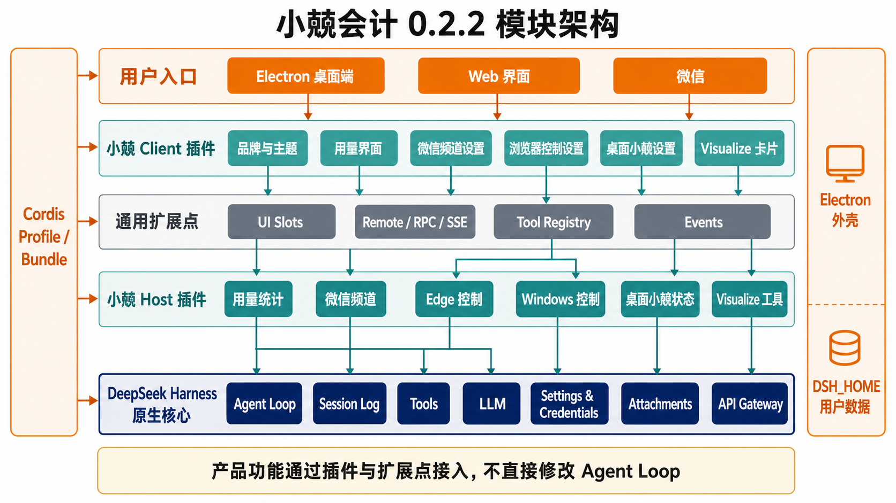
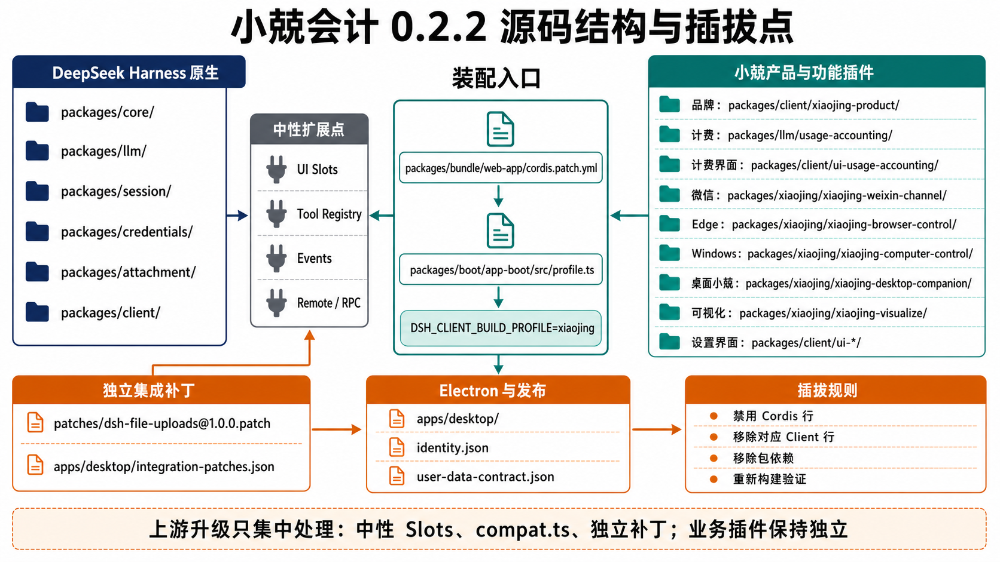

# 小兢会计 0.2.2 模块架构与源码结构

[English](xiaojing-module-architecture.md) | 中文

本文是小兢会计 0.2.2 的跨模块导航图，回答三件事：DeepSeek Harness 原生代码负责什么，小兢会计新增代码位于哪里，以及每项能力通过什么扩展点装入或移除。具体行为仍以源码、包 README 和[产品开发基线](xiaojing-product-development.zh.md)为准。

## 基线与结论

| 项目 | 当前值 | 真源 |
|---|---|---|
| 桌面版本 | `0.2.2` | [`apps/desktop/package.json`](../apps/desktop/package.json) |
| Harness 基线 | `dsh-v0.1.1-rc.2` / `b150a551...` | [`packages/client/xiaojing-product/product.json`](../packages/client/xiaojing-product/product.json) |
| 运行时装配 | Cordis profile、bundle 和配置行 | [`packages/boot/app-boot/src/profile.ts`](../packages/boot/app-boot/src/profile.ts)、[`packages/bundle/web-app/cordis.patch.yml`](../packages/bundle/web-app/cordis.patch.yml) |
| Xiaojing Client 选择器 | `DSH_CLIENT_BUILD_PROFILE=xiaojing` | [`scripts/client-build-environment.ts`](../scripts/client-build-environment.ts) |

当前架构的主体是可扩展的：品牌、计费、微信、Edge、Windows 操控、桌面小兢和 Visualize 都有独立包，没有把业务实现写入 `agent-loop`。仍有三处需要明确看作集成层，而不是纯单行插件：产品配置行目前位于共享 `web-app` bundle、文件上传依赖外部包及 pnpm patch、桌面小兢的原生窗口和托盘必须由 Electron 外壳承载。

## 运行时模块架构



图中的颜色含义固定如下：

- 深蓝：DeepSeek Harness 原生能力及其数据模型。
- 灰色：产品无关的扩展点，包括 UI Slots、Tool Registry、事件和 Remote/RPC。
- 浅绿与深绿：小兢产品插件和功能插件。
- 橙色：Electron、系统托盘、外部通道和独立集成补丁。

一次桌面请求的主要链路是：Electron 加载组装后的 Web Client，Client 插件通过 slots 渲染界面，通过 Remote/RPC 调用 Host；Host 功能插件通过工具注册、事件监听或 LLM waterfall 接入 Harness；Agent Loop 继续由上游实现负责。微信任务从 iLink 进入微信 Host 插件后使用正常的 `sessions.prompt()` 入口，因此与桌面请求共享会话、工具、审批和日志语义。

## 各层职责

| 层级 | 负责内容 | 不应负责内容 |
|---|---|---|
| Harness 原生核心 | Agent、Agent Loop、Session Log、工具执行、LLM、设置、凭据、附件和 API 网关 | 小兢品牌文案、数豆主题、微信协议或桌面宠物 |
| 中性扩展点 | UI slot 声明、工具注册、事件、Remote/RPC、fallback UI | 某个产品的具体行为和资源 |
| 小兢 Host 插件 | 计费、微信、浏览器、Windows、桌面状态和可视化工具 | 直接操作 React 页面或 Electron BrowserWindow |
| 小兢 Client 插件 | 品牌、设置栏目、侧边栏摘要、卡片和 Host 状态投影 | API Key、微信 Token、文件系统或任意 Node 能力 |
| Electron 外壳 | 主窗口、托盘、桌面小兢窗口、受限 preload、随包运行时和安装器 | Agent 业务逻辑、计费结算和网页自动化规则 |
| Profile / Bundle | 决定加载哪些插件及加载顺序 | 在装配文件内实现业务算法 |

## 功能插入关系

| 功能 | Host owner | Client owner | 使用的扩展点 | 持久化 owner | 完整移除范围 |
|---|---|---|---|---|---|
| 品牌与默认人格 | [`packages/client/xiaojing-product/`](../packages/client/xiaojing-product/) | 同一包的 `src/client/` | `system-prompt/assemble`、五个品牌 slot、`settings.section` | 用户人格仍由 Harness 设置和预设 owner 保存 | 移除 `xiaojing-product` 配置行并使用 official Client profile |
| Finance 模式基础层 | [`apps/cli/config/xiaojing-agent-presets/finance/`](../apps/cli/config/xiaojing-agent-presets/finance/) 组装；当前没有 Finance Host 服务 | [`xiaojing-product`](../packages/client/xiaojing-product/) 中的 Finance 显示提供方 | 小兢专属预设根目录、`AgentPresetDisplayRegistry` 和产品清单检查 | 预留 `$DSH_HOME/finance`；基础层不写入数据 | 同时移除产品预设、显示注册、清单项和聚焦检查；官方预设名单不变 |
| 本机用量 | [`packages/llm/usage-accounting/`](../packages/llm/usage-accounting/) | [`packages/client/ui-usage-accounting/`](../packages/client/ui-usage-accounting/) | `llm/stream`、Typert Remote、`usage-accounting/updated`、侧边栏和设置 slot | `$DSH_HOME/usage-accounting/usage-v1.json` | 同时移除 Host 与 Client 配置行；历史账本可保留 |
| 文件与图片上传 | `dsh-file-uploads` bundle、原生 attachment 服务 | 外部插件 Client 与通用 `conversation.addImages()` | profile bundle、原生图片入口、composer slot | `$DSH_HOME/uploads`、`$DSH_HOME/attachments/v1` | 移除 profile bundle、应用依赖和 pnpm patch；这不是单行纯插件 |
| 微信频道 | [`packages/xiaojing/xiaojing-weixin-channel/`](../packages/xiaojing/xiaojing-weixin-channel/) | [`packages/client/ui-weixin-channel/`](../packages/client/ui-weixin-channel/) | `sessions.prompt()`、Agent/Session/Approval 事件、loopback RPC | 凭据服务、`$DSH_HOME/weixin-channel`、共享附件目录 | 同时移除 Host 与 Client 配置行 |
| Edge 浏览器控制 | [`packages/xiaojing/xiaojing-browser-control/`](../packages/xiaojing/xiaojing-browser-control/) | [`packages/client/ui-xiaojing-browser-control/`](../packages/client/ui-xiaojing-browser-control/) | `ctx.tools`、Session 事件、loopback RPC、Playwright/扩展桥 | `$DSH_HOME/browser-control/profile`、桥接凭据 | 移除 Host 与 Client 配置行；随包扩展资源随后可删除 |
| Windows 电脑控制 | [`packages/xiaojing/xiaojing-computer-control/`](../packages/xiaojing/xiaojing-computer-control/) | 无独立设置页 | `ctx.tools`、审批服务、受控 PowerShell helper | 无业务账本 | 移除 Host 配置行 |
| 桌面小兢 | [`packages/xiaojing/xiaojing-desktop-companion/`](../packages/xiaojing/xiaojing-desktop-companion/) | [`packages/client/ui-desktop-companion/`](../packages/client/ui-desktop-companion/) | Session/微信状态事件、loopback SSE、受限 preload | `desktop-companion/preferences-v1.json` | 移除 Host/Client 行只会移除状态和设置；完整移除还需删除 Electron 窗口、托盘菜单和素材接线 |
| Visualize | [`packages/xiaojing/xiaojing-visualize/`](../packages/xiaojing/xiaojing-visualize/) | 同一包的 `src/client/` | `ctx.tools`、skill provider、工具结果 renderer | Session 工具结果和工作区副本 | 移除唯一 `xiaojing-visualize` 配置行及包依赖 |

## 源码结构与插拔点



```text
E:/Projects/sudo agent/
├─ packages/
│  ├─ core/
│  ├─ llm/
│  │  └─ usage-accounting/
│  ├─ attachment/
│  ├─ client/
│  │  ├─ ui-*/
│  │  ├─ xiaojing-product/
│  │  ├─ ui-usage-accounting/
│  │  ├─ ui-weixin-channel/
│  │  ├─ ui-xiaojing-browser-control/
│  │  └─ ui-desktop-companion/
│  ├─ xiaojing/
│  │  ├─ xiaojing-browser-control/
│  │  ├─ xiaojing-computer-control/
│  │  ├─ xiaojing-weixin-channel/
│  │  ├─ xiaojing-desktop-companion/
│  │  └─ xiaojing-visualize/
│  ├─ bundle/web-app/
│  └─ boot/app-boot/
├─ apps/
│  ├─ cli/config/
│  │  ├─ agent-presets/
│  │  └─ xiaojing-agent-presets/finance/
│  ├─ web/
│  └─ desktop/
├─ patches/
│  └─ dsh-file-uploads@1.0.0.patch
└─ scripts/
   └─ verify-xiaojing-product-layer.mjs
```

## 装配过程

1. `PROFILE_TEMPLATES.web` 依次加载 `dsh-base`、`dsh-web-app` 和 `dsh-file-uploads`。
2. profile 启动始终挂载官方预设根目录，只有 `DSH_CLIENT_BUILD_PROFILE=xiaojing` 时才增加 `xiaojing-agent-presets`。
3. `dsh-web-app` 的 `cordis.patch.yml` 插入 Host 行和带 `dsh.client` 声明的 Client 行。
4. `client-modules` 扫描 Client 名录并生成 `window.__DSH_BOOT__`；浏览器端 Cordis 再按该名录安装 Client 插件。
5. Xiaojing 构建 profile 允许产品 Client 插件注册品牌、Finance 显示文案和产品专属设置；official 构建保留中性 fallback。
6. Electron 启动同一 Web profile，固定用户数据根目录，并只通过 preload 暴露经过列举的桌面方法。

Cordis 注册返回 disposer，`ctx.effect()` 和 `ctx.on()` 会在插件卸载时撤销注册，因此插件不能绕过 Cordis 在模块顶层写永久全局副作用。Host 与 Client 的连接应经过公开 Remote、RPC、SSE 或事件，不应彼此导入内部实现。

## 插拔操作分级

### 纯 Cordis 功能

Visualize 和 Windows 控制可以通过单个 Host 配置行关闭。计费、微信和 Edge 由一对 Host/Client 行组成，应成对关闭，避免留下无数据的设置页或没有入口的 Host 服务。

### 产品 UI 功能

品牌由 `xiaojing-product` 一行提供，但产品构建环境仍决定哪些字节进入 Client 产物。验证“可移除”必须同时执行 official Client 构建，确认中性 fallback 可以独立运行。

Finance 基础层的移除范围比整个产品 UI 更窄：同时删除产品预设目录、显示注册、清单项和聚焦检查。当前还没有 Host 或 Client 服务配置行，预留的 Finance 持久化根目录可以保持为空。

### 原生桌面功能

桌面小兢的状态聚合和设置页是 Cordis 插件，透明窗口、托盘和动画属于 Electron。完整移除必须通过一个受控变更同时删除三处接线，不能只删 UI 组件后留下后台窗口生命周期。

### 第三方集成补丁

`dsh-file-uploads` 通过 profile、应用依赖和 pnpm patch 交付。它当前具备独立清单和聚焦测试，但不是上游无侵入插件；每次 Harness 升级都必须重新核对 patch 是否仍适用。

## 防止演变成屎山的强制规则

1. **不修改 Agent Loop。** 新能力优先使用工具、事件、waterfall、Remote 或 UI slot；确实缺少扩展点时，只在上游 owner 增加中性最小接口。
2. **一个功能只有一个 owner。** 结算归计费 Host，显示归计费 Client，窗口归 Electron；不得在多个包复制同一业务判断。
3. **Host 与 Client 只通过稳定接口连接。** Client 不导入 Host 内部文件，Host 不依赖 React；敏感凭据和文件路径不进入浏览器快照。
4. **跨版本变化集中到适配文件。** LLM 版本差异进入 `usage-accounting/src/compat.ts`；产品界面变化进入中性 slots；外部包差异进入 `integration-patches.json` 清单。
5. **每个持久文件由一个插件拥有。** 文件携带 schema 版本，迁移必须原子写入并保留失败前原文件；安装器不能把应用目录和用户数据目录混为一体。
6. **每项功能必须可以独立关闭并测试。** 测试至少证明启用、关闭、重启恢复、数据保留和卸载后其他功能不变。
7. **禁止隐藏的跨插件耦合。** 共享数据应提升为有类型的 service、event 或 Remote；不能通过读取另一个插件的私有 JSON 或 DOM 结构协作。
8. **装配层只列清单。** `cordis.patch.yml` 只负责插件、顺序和配置，不放业务算法。

## 下一步架构收敛建议

当前最值得优先处理的不是重写现有功能，而是把全部产品配置行从共享 [`packages/bundle/web-app/cordis.patch.yml`](../packages/bundle/web-app/cordis.patch.yml) 移到单独的 `packages/bundle/xiaojing-app/cordis.patch.yml`。目标组合应是 `dsh-base → dsh-web-app → dsh-file-uploads → xiaojing-app`。这样下一次上游升级主要比较原生 `web-app`，小兢功能的增删只修改产品 bundle，并能从配置层真正证明 official profile 不加载任何小兢 Host 工具。

Finance 已经通过 `product.json.financeExtension` 建立该模式：包名前缀、组合行前缀、兼容适配规则、受保护数据根目录及精确 Host/Client 包清单会被一起检查。专属产品 bundle 完成后，应把同一种清单驱动的检查扩展到其他功能，避免只移除一半功能或新增包后忘记更新发布保护清单；在出现第二个消费者之前，不需要额外创建抽象框架或跨功能基类。

## 新功能目录模板

```text
packages/xiaojing/xiaojing-<feature>/
├─ src/index.ts
├─ src/types.ts
├─ src/compat.ts
├─ tests/
└─ README.md / README.zh.md

packages/client/ui-xiaojing-<feature>/
├─ src/client/index.ts
├─ src/client/*.tsx
├─ tests/
└─ README.md / README.zh.md
```

Finance 能力包使用产品清单声明的更窄命名：`xiaojing-finance-<capability>` 与 `ui-xiaojing-finance-<capability>`。在一条完整 Service Definition、提供方和消费方链路可以交付前，不创建其中任何包。

新功能开始编码前必须先写清楚：Host owner、Client owner、使用的扩展点、持久化路径、敏感数据边界、配置行、完整移除步骤和聚焦验证。无法回答其中一项时，说明模块边界尚未设计完成。
