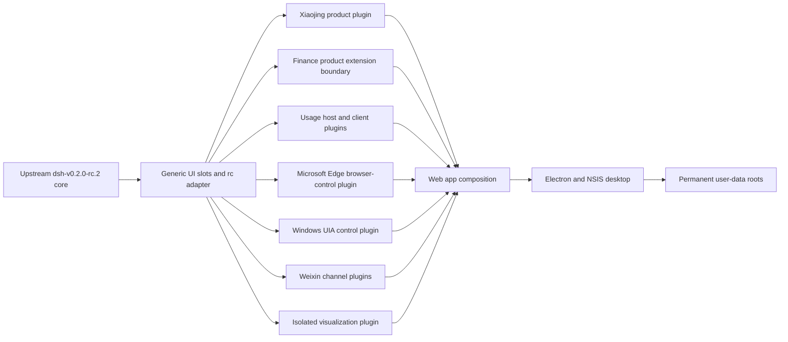

# Xiaojing Accounting product development baseline (0.3.2)

English | [中文](xiaojing-product-development.zh.md)

This reference defines how Xiaojing Accounting is assembled on DeepSeek Harness, which source layer owns each customization, and which compatibility rules a later development session must preserve. It describes the current 0.3.2 source baseline on official `dsh-v0.2.0-rc.2`; package READMEs own package-level details, while the [0.1.9 architecture decision](../.agents/notes/implemented/architecture/2026-08-20-xiaojing-product-accounting-and-desktop-upgrades.md), [rc.8 upgrade decision](../.agents/notes/implemented/architecture/2026-08-20-xiaojing-rc8-upgrade.md), [rc.1 native-vision upgrade decision](../.agents/notes/implemented/architecture/2026-08-21-xiaojing-rc1-native-vision-upgrade.md), [rc.2 image-pipeline and visualization decision](../.agents/notes/implemented/architecture/2026-08-24-xiaojing-rc2-files-and-visualization-upgrade.md), and [desktop companion and tray decision](../.agents/notes/implemented/feature/2026-08-25-xiaojing-desktop-companion-and-tray.md) own the rationale and rejected alternatives.

Read the [module and source architecture map](xiaojing-module-architecture.md) first when you need a quick view of the upstream core, Xiaojing plugins, Electron shell, and source directories.

## Read this first

Before editing product code, identify the owning layer instead of starting from the visible component. The following rules are release requirements:

- Product names, logos, copy, theme values, onboarding, and the default deployment persona belong to the Xiaojing product plugin or application metadata, never directly in an official UI owner.
- New behavior is a Cordis plugin that uses an existing extension point, Remote, event, or slot. A minimal provider-neutral extension point may be added to an official package when none exists; product behavior must not be embedded there.
- Installer identity and permanent user-data paths are compatibility identifiers. They do not change during ordinary product or upstream upgrades.
- Preview and focused verification precede packaging. Do not build or install a Windows release until the requested behavior has been accepted in the running preview.

## Milestone baseline

| Item | Current value | Source of truth |
|---|---|---|
| Desktop product version | `0.3.2` | [`apps/desktop/identity.json.productVersion`](../apps/desktop/package.json) |
| Official Harness baseline | `dsh-v0.2.0-rc.2` | [`product.json`](../packages/client/xiaojing-product/product.json) |
| Official baseline commit | `dsh-v0.2.0-rc.2` | [`product.json`](../packages/client/xiaojing-product/product.json) |
| Product integration base | `xiaojing-history-20260930-4` | [`product.json`](../packages/client/xiaojing-product/product.json) |
| Source repository | `git@github.com:yyshi127/sudotech_agent_harness.git` | Git `origin` |

`product.json` is the explicit upstream record; do not infer the baseline from similar-looking source. The `@deepseek-ai/dsh-*` package scope remains the repository-wide workspace convention, while the desktop package uses `@deepseek-ai/dsh-desktop`. Product copy and attribution must continue to state that Xiaojing Accounting is based on DeepSeek Harness with internal branding and configuration, not that Sudotech developed the underlying framework.

## Architecture



The lowest layer that can own a change owns it. Official packages expose neutral extension points; product and feature plugins implement observable behavior; the Web bundle composes those plugins; Electron packages the assembled application without becoming the owner of browser features.

## Source ownership

| Layer | Responsibility | Primary sources |
|---|---|---|
| Official-compatible UI owners | Product-neutral slots, owner props, fallback UI, and generic startup-logo metadata reading | `packages/client/ui-sidebar/`, `packages/client/ui-conversation/`, `packages/client/ui-settings-models/`, `packages/client/web/` |
| Xiaojing product layer | Brand components, palette, product copy, onboarding, and default deployment persona | [`packages/client/xiaojing-product/`](../packages/client/xiaojing-product/README.md) |
| Finance domain Host plugin | Local taxpayer records, dedicated Finance Workspaces, revision-safe storage, immutable session binding, controlled client-file lifecycle, safe projection, Remote, and Finance prompt context | [`packages/xiaojing/xiaojing-finance-domain/`](../packages/xiaojing/xiaojing-finance-domain/README.md) |
| Finance clients Client plugin | Client settings, compact consultation/client selection, Finance workspace category, preset routing, composer gating, unified-upload handoff, and read-only session labels | [`packages/client/ui-xiaojing-finance-clients/`](../packages/client/ui-xiaojing-finance-clients/README.md) |
| Usage Host plugin | Provider usage observation, API-key fingerprinting, built-in pricing, immutable ledger, Remote, and update event | [`packages/llm/usage-accounting/`](../packages/llm/usage-accounting/README.md) |
| Usage Client plugin | Sidebar summary and detail panel, Settings entry, monthly calendar, formatting, and refresh controller | [`packages/client/ui-usage-accounting/`](../packages/client/ui-usage-accounting/README.md) |
| Browser-control plugins | Dedicated and optional personal Edge adapters, global page discovery, per-turn leases, bounded semantic DOM actions, extension pairing, and high-impact approval | [`packages/xiaojing/xiaojing-browser-control/`](../packages/xiaojing/xiaojing-browser-control/README.md), [`packages/client/ui-xiaojing-browser-control/`](../packages/client/ui-xiaojing-browser-control/README.md) |
| Computer-control plugin | Windows PowerShell helper lifecycle, UI Automation observations, semantic native actions, and high-impact approval | [`packages/xiaojing/xiaojing-computer-control/`](../packages/xiaojing/xiaojing-computer-control/README.md) |
| Weixin Host plugin | Tencent iLink pairing, private credentials and state, durable Agent session bridge, approvals, and mobile text delivery | [`packages/xiaojing/xiaojing-weixin-channel/`](../packages/xiaojing/xiaojing-weixin-channel/README.md) |
| Weixin Client plugin | Loopback-only channel settings, QR pairing, verification, and sanitized connection state | [`packages/client/ui-weixin-channel/`](../packages/client/ui-weixin-channel/README.md) |
| Desktop-companion Host plugin | Content-free task-state aggregation and loopback-only snapshot/SSE transport | [`packages/xiaojing/xiaojing-desktop-companion/`](../packages/xiaojing/xiaojing-desktop-companion/README.md) |
| Desktop-companion Client plugin | Xiaojing-only settings section and validated restricted preload calls | [`packages/client/ui-desktop-companion/`](../packages/client/ui-desktop-companion/README.md) |
| Visualization plugin | Model-facing visualization tool and skill, sandboxed Web cards, and a fixed light palette isolated from the host theme | [`packages/xiaojing/xiaojing-visualize/`](../packages/xiaojing/xiaojing-visualize/README.md) |
| Web composition | Host and browser plugin roster and load order | [`packages/bundle/web-app/cordis.patch.yml`](../packages/bundle/web-app/cordis.patch.yml) |
| Independent integration patches | API-key post-configuration, profile runtime-shadow protection, and the unified document/native-image upload bridge with composer repair | [`apps/desktop/integration-patches.json`](../apps/desktop/integration-patches.json) |
| Desktop and installer | Electron lifecycle, bundled Node runtime, icons, splash, fixed window identity, NSIS configuration, and release checks | [`apps/desktop/`](../apps/desktop/README.md) |
| Durable API reference | Client-safe usage types, Remote method, and update event | [`docs/subsystems/usage-accounting.md`](subsystems/usage-accounting.md) |

Do not duplicate detailed package contracts in this document. Update the owning README or subsystem reference first, then keep this page as the cross-layer map and continuation procedure.

## UI and product isolation

### Generic owners

The official-compatible UI roots expose six Xiaojing-required single-owner slots: `sidebar.brand.mark`, `sidebar.brand.name`, `conversation.hero.brand.mark`, `conversation.hero.brand.content`, `conversation.hero.context`, and `onboarding.content`. Each owner retains a neutral fallback so the upstream-style application still runs when the product or Finance Client plugin is absent. Generic code may define owner props, layout space, design tokens, metadata keys, and fallback rendering; it may not import a Xiaojing package or mention Xiaojing, Sudotech, SUDO, product asset filenames, or product copy.

The generic Agent-preset Client exposes `AgentPresetDisplayRegistry` for product-owned presets. A product plugin registers active-locale copy for its preset id; unmatched rows fall back to their published name and description. The four upstream declarations use generic locale dictionaries, so the generic Client contains no Xiaojing id or wording.

[`scripts/verify-xiaojing-product-layer.mjs`](../scripts/verify-xiaojing-product-layer.mjs) scans the official UI source roots for product marks, verifies each declared slot, verifies inventoried assets and desktop manifests, and requires the Web composition to load the product plugin. A packaging command fails when this isolation check fails.

### Product plugin

`@deepseek-ai/dsh-client-xiaojing-product` has a Host face and a browser face. The Host face fills an empty `deployment:persona` section with the Xiaojing identity but never replaces a selected or user-created agent persona. The browser face registers the five product slots, localized copy, and theme CSS as one unloadable plugin, and its registrations are compiled only by the `xiaojing` Client build profile. The same lifecycle synchronizes the existing browser `theme-color` metadata after the product dataset is attached, then restores the generic value when the product plugin unloads.

This browser face registers active-locale Finance display copy through the generic `AgentPresetDisplayRegistry`. `apps/cli/config/xiaojing-agent-presets/finance/agent.cordis.yml` is an ordinary patch whose `preset-finance` row declares the `finance` id, fallback name and description, order, and child plugin list through `@deepseek-ai/dsh-agent-preset`. Profile boot inserts this patch only for the `xiaojing` build profile, after bundle patches and before profile, home, and command-line overlays; official and unknown builds do not receive it.

All ordinary brand changes start in this package. Add or replace the asset in the application public assets, update `product.json` when the inventory changes, and reference it from the product component. Do not solve a missing product presentation by directly editing `SidebarRoot`, `EmptyHero`, `WelcomeNotice`, or another official owner.

### Startup surfaces

There are two startup presentations, and both must remain branded:

1. [`apps/desktop/src/client/WelcomePage.tsx`](../apps/desktop/src/client/WelcomePage.tsx) is the RC1 Electron welcome surface shown while the local Host starts. Its copy comes from the Desktop locale dictionaries.
2. The `xiaojing` entry in [`scripts/client-build-environment.ts`](../scripts/client-build-environment.ts) injects `dsh-boot-logo` metadata into the built Web shell. The generic boot page reads that metadata and retains `HARNESS` as its fallback; [`apps/web/index.html`](../apps/web/index.html) itself stays product-neutral.

A startup-brand change is incomplete if only one surface is checked. Verify the Electron splash, the Web plugin-loading screen, the expanded and collapsed sidebar, the empty-conversation hero, and onboarding.

### Adding product UI

1. Decide whether the change is brand presentation or a reusable feature. Brand presentation belongs in `xiaojing-product`; a reusable feature gets its own Host and/or Client package.
2. Use an existing slot when its owner props provide the required state and actions.
3. If no slot exists, add the smallest provider-neutral slot to the owning official package, retain a complete fallback, and add owner and snapshot tests.
4. Add the slot name to `product.json` only when the Xiaojing product plugin consumes it, then extend the product-layer check if the ownership rule changes.
5. Register the product renderer from the product package and verify unloading it restores the generic fallback.

## Functional plugin isolation

### Finance client domain

The declarative Finance preset retains every Standard-mode composition row except its persona, adds the five product skills through its filesystem skill provider, and adds the product-specific consumers for customer context, managed files, Youcheng queries and controlled maintenance, deterministic calculations, document reading, and official-source research. The product verifier compares the parsed `preset-standard` and `preset-finance` declarations, permits only those Finance additions, and requires the Host and Client packages inventoried in `product.json.financeExtension` to appear in the Xiaojing Web composition. Official Harness builds never receive the Finance patch.

`@deepseek-ai/dsh-xiaojing-finance-domain` stores one local record per taxpayer entity in schema-versioned `$DSH_HOME/finance/clients-v1.json`. Whole-file revisions reject stale writes, file locking and atomic replacement prevent torn writes, and corrupt data stops plugin startup without overwriting the source. Records are archived rather than deleted. External-system references contain only Youcheng or SDOO identifiers, never credentials.

A blank Finance session defaults to general financial consultation. The Client may stage a client in Host memory until the first turn. Before the first model request, the preset consumer appends and flushes one immutable `finance/client-bound` event containing only the selected record snapshot and record version. Historical sessions therefore keep their original facts when the current client record changes. The `financeClient` projection exposes only client display name and state; future client-specific services must call `requireBoundClient()` and reject general sessions. A month, quarter, or year belongs to the specific Finance Skill request, not the client or session.

`@deepseek-ai/dsh-client-ui-xiaojing-finance-clients` registers Customer Management at Settings order 22 and fills the product-neutral `conversation.hero.context` slot for blank Finance sessions. The `Consultation / Client` selector blocks only its own composer condition while client mode has no selected client; the owner-aware block registry preserves independent model, upload, Goal, and Plan constraints. After the first turn, the selector becomes a read-only client label. Removing the two product composition rows removes the feature without changing Standard mode or official UI owners.

The desktop sets `XIAOJING_FINANCE_WORKSPACE_ROOT` to `Documents/小兢会计工作区/Finance工作区`. The Host registers one Workspace displayed as `Consultation` and one stable-client-id Workspace per customer; profile, policy, source, session-isolated work, deliverable, and archive directories remain below the customer root. Finance Skills create period-specific children when a task needs them. A client session's `cwd` must equal the selected customer root, while a consultation's `cwd` must equal the fixed directory. Invalid combinations reject before model use. Failed client creation rolls back its new directory and Workspace registration; startup removes an interrupted registration without deleting files.

The existing upload picker emits an optional product-neutral preparation event before its legacy upload. A bound Finance client session claims the event, performs the upload lazily once, and asks the Host to copy the resulting local file into `02-原始资料`; ordinary and Finance consultation sessions leave the event unclaimed and retain the original upload behavior. Each bound session receives a private directory below `03-会话作业`. The `finance_files` tool interprets natural finalization intent such as export, delivery, final output, or formal save as a controlled copy from that session directory into `04-成果输出`; only explicit archive intent copies managed customer material into `05-归档`. The append-only managed-file index records SHA-256, source stage, destination, session, and the corresponding `finance/file-*` event. These operations preserve their source files. The Host package README owns the complete path and failure rules.

Generic `ui-workspace` accepts product categories, optional nested sections, and the current preset's picker scope through `WorkspaceCategoryRegistry` but does not recognize Finance. The Finance Client plugin supplies `Regular workspaces / Finance workspaces` labels and membership: `Consultation` stays at the Finance root, while `Client workspaces` contains every customer. The composer picker also lists only the current preset's Workspaces. Selecting Finance enters consultation, selecting a client enters its Workspace first, and leaving Finance returns to a regular Workspace. Removing the Finance Client registration restores a generic sidebar with no Finance condition.

### Shared local document normalization

`@deepseek-ai/dsh-xiaojing-finance-documents` owns one deterministic parser core and two source-authorization adapters. The Finance adapter consumes immutable customer or consultation import events and revalidates canonical path, regular-file state, size, and SHA-256. The ordinary-session adapter consumes only durable human `user/message` upload references from the current session, confines them to the protected Xiaojing upload root, and rejects arbitrary paths or plugin-authored text. Both adapters parse PDFs, DOCX, XLSX, PPTX, CSV, and TXT in the same serialized, memory-bounded Worker.

PPTX normalization retains ordered shape and table text, speaker notes, and slide references for embedded PNG, JPEG, WebP, and GIF files. For PDF, pages with useful text layers retain deterministic text while text-poor pages are rendered locally as bounded PNG files. The bounded `visuals` action sends rendered scan pages and retained document pictures to the exact active image-capable model with source locators. Charts, SmartArt, vectors, media, and embedded objects are not otherwise reconstructed. The package performs no OCR and calls no external parsing service.

Normalized records use schema version `3` and normalizer version `4` below `$DSH_HOME/finance/documents/v3/normalizer-v4/<scope-hash>/`; all earlier normalizer and schema directories remain untouched. The normalizer-specific directory prevents stale pre-render records from hiding scan visuals. File locking and atomic replacement protect writes, and each Finance customer, Finance consultation, or ordinary session receives an isolated scope. Corrupt records stop plugin initialization and remain unchanged.

The Xiaojing-only global `document_reader` gives every non-Finance preset `list`, `read`, and `visuals` actions. Finance registers the equivalent `finance_document` tool and hides the ordinary tool in its Agent scope, preserving customer authorization without duplicating the parser. Content reaches the model only through logged tool results and never through standing prompt injection. Removing the Host and ordinary consumer rows removes the shared capability; removing the Finance consumer independently removes its Finance adapter. The package [README](../packages/xiaojing/xiaojing-finance-documents/README.md) owns format, storage, limit, and failure details.

### Official finance-tax evidence

`@deepseek-ai/dsh-xiaojing-finance-evidence` uses the existing Web search service for discovery, then privately fetches only HTTPS pages admitted by its official-source registry. Search snippets never become evidence. The service classifies fetched text by authority, legal effect, lifecycle relative to the requested date, and conditional applicability. A bound client's registered region may default local discovery, but it never establishes that a rule applies to that client.

The Finance-only `finance_evidence` tool returns `verified`, `partial`, `pending`, or `out-of-scope` evidence availability and persists the complete structured result in `tool/result`. Partial or pending propositions remain `待核验`. Rights stay `terms-review-pending`; the product does not claim a complete official corpus, cleared redistribution rights, or coverage outside Chinese mainland jurisdiction.

`$DSH_HOME/finance/evidence-cache-v1.json` stores schema-versioned metadata, bounded official-text excerpts, hashes, and retrieval state with file locking and atomic replacement. It does not store search snippets, a bulk legal corpus, credentials, or client records. Removing the Host row and Finance consumer row removes official evidence research without changing the customer domain or Standard mode. The package [README](../packages/xiaojing/xiaojing-finance-evidence/README.md) owns retrieval, failure, and model-experience details.

### Deterministic Finance trial calculations

`@deepseek-ai/dsh-xiaojing-finance-calculations` provides a complete Host service, Finance-only `finance_calculation` consumer, and package-owned invariant companion without changing `agent-loop`. Its first immutable rule pack, `cn-mainland-2026-v1`, supports dates from 2026-01-01 through 2027-12-31 and covers one-rate general-taxpayer VAT, bounded small-scale VAT examples, VAT-derived surcharges, enterprise-income-tax prepayment examples, and cumulative resident salary withholding. Every request uses decimal-string yuan amounts, explicit eligibility choices, exact decimal arithmetic, named formulas, fixed rounding, official rule references, applicability warnings, and a mandatory trial-only disclaimer.

A bound customer supplies only the taxpayer type and registered region from the immutable `finance/client-bound` snapshot. A conflicting taxpayer type is rejected; a consultation must provide the type explicitly. Missing facts produce `needs-input`, unsupported dates produce `unsupported`, and neither path guesses a rate or result. The package creates no separate ledger: the normal `tool/call` and `tool/result` events retain the request and complete audit trace. Removing the Host and preset rows removes the calculator without changing customer, document, evidence, or Standard-mode behavior.

The Finance skill directory contains exactly five product skills: `finance-tax-research-cn`, `finance-document-reading`, `finance-invoice-review`, `finance-voucher-draft`, and `finance-data-analysis`. These workflows normally coordinate existing document, evidence, calculation, and controlled-file tools to prepare reviewable conclusions and drafts. The voucher skill can create a Youcheng voucher only after an explicit request, versioned preview, mandatory approval, and verified readback; it does not post vouchers, file returns, approve reimbursements, or make payments. No reimbursement skill is shipped.

### Finance Stage 1 integrated acceptance

The keyless Stage 1 assembled snapshot mounts the shipped Xiaojing composition with one Standard agent and two Finance customer agents. It pins the exact Finance tool and skill additions, proves Standard mode remains free of Finance tools, keeps customer prompt context and identical source bytes isolated by customer, rejects cross-customer document ids, preserves source-row locations, selects deterministic VAT behavior from each immutable customer binding, and refuses a Hong Kong tax request as outside the mainland scope. The desktop user-data verifier separately reads two synthetic prior-version Finance records through the production store, verifies private fields and every managed workspace stage, and proves that compatibility reads leave protected bytes unchanged. The [acceptance Agent Note](../.agents/notes/implemented/testing/2026-08-29-xiaojing-finance-stage1-integrated-acceptance.md) owns the rationale and limits.

This gate establishes source readiness only. Live official-site retrieval, model answers, Electron behavior, Windows installation, and in-place upgrade remain manual release checks; no package is generated while an applicable product or data-preservation check fails.

### Local usage accounting

The accounting feature does not modify the agent loop. `@deepseek-ai/dsh-usage-accounting` observes actual `deepseek-official` calls through the rc.2 `llm/stream` waterfall. [`compat.ts`](../packages/llm/usage-accounting/src/compat.ts) is the only file that imports the rc-specific stream, token usage, DeepSeek settings, endpoint, and credential APIs. An upstream API change should therefore be absorbed there before changing settlement, storage, pricing, or UI logic.

Each request settles at most once on its first provider `usage` chunk. Conversation, compaction, title, and retry requests remain distinct. The ledger stores only a SHA-256 key fingerprint, request metadata, disjoint token buckets, the request-time tariff version, integer-nanoyuan category costs, total cost, and unpriced tokens. The browser receives only `usageAccounting.snapshot()` and the `usage-accounting/updated` refresh signal; it never receives a key or fingerprint.

The current Flash and Pro table in [`pricing.ts`](../packages/llm/usage-accounting/src/pricing.ts) is the only tariff source for new requests; the current Flash id and its callable legacy ids use the Flash tariff. Retained prior tables only recover missing category details in historical rows. Startup performs no pricing request. The UI rounds exact nanoyuan values to fen for display and always shows two decimals; the ledger retains nanoyuan precision. Vision image consumption comes from provider usage and is not estimated locally. Unknown models, custom endpoints, and cache-write tokens remain counted but unpriced. This is a local calculation from provider usage, not a DeepSeek Platform invoice or balance.

### Built-in browser and Windows automation

`@deepseek-ai/dsh-xiaojing-browser-control` and `@deepseek-ai/dsh-xiaojing-computer-control` are independent Cordis capability plugins and do not modify `agent-loop` or official UI packages. The Web composition enables both by default; a development overlay can disable either row. `@deepseek-ai/dsh-client-ui-xiaojing-browser-control` independently contributes the loopback-only “Browser Control” settings section and disappears when its composition row is removed. Their tools are deployment-global by design, so every new session, including a user-authored preset that suppresses runtime context, receives both schemas and their routing descriptions. Sessions that accept runtime context also receive the Xiaojing Host product contribution: direct file, data, editing, and command tools remain primary when no visible UI is required; websites use `browser_control`; native visible applications use `computer_control`.

Browser control has two adapters behind one removable Cordis tool. The default managed adapter starts installed Microsoft Edge visibly with a dedicated persistent profile and controls it through Playwright. The optional personal adapter attaches only to an explicitly paired sideloaded Manifest V3 extension, so it can operate ordinary HTTP or HTTPS tabs that the user opened in personal Edge. The settings plugin exposes managed-state diagnostics, extension location, Edge extension-manager access, one-time pairing, revocation, protocol version, and sanitized connection state. The extension bridge listens only on `127.0.0.1` within ports `53170–53179`, authenticates a fixed extension identity and protocol, stores its long-term secret only in the Harness credential service and extension local storage, and uses nonce-bound HMAC proofs for routine reconnects instead of transmitting that secret again.

The browser coordinator keeps a process-wide page registry and grants one session a page lease for one Agent turn. It first reuses a matching page already bound to the session, then a matching active personal page, another exact URL, an appropriate same-origin page, or a managed blank page; it creates a managed tab only when no reusable target exists. A new top-level window is created only when the caller explicitly asks for one. Personal Edge disconnection stops the active task without replaying completed work in managed Edge, and `turn/end`, cancellation, and failure release the lease so desktop and Weixin tasks cannot operate the same page concurrently.

Each frame is scanned once per observation, including nested frames and open shadow roots. Bounded semantic targets record role, accessible name, state, and nearby dialog, row, and region context. Actions resolve that semantic fingerprint again before acting, so a React replacement can be followed when its identity remains stable while a changed context is rejected. The `act` action performs a bounded list of click, fill, type, select, check, uncheck, hover, press, scroll, upload, and wait steps with Playwright or extension-side DOM waits. It validates each completed step, stops at the first failure, and reports completed and failed steps without replay. Ordinary DOM work remains in the background; `show` is the explicit foreground action. Screenshot coordinates, UI Automation, and `computer_control` are not automatic webpage fallbacks.

Both capability plugins reject IDs owned by another session, recover after an interrupted owned process, stop owned processes on plugin disposal, and fail closed when a protected action has no approval channel. Private or loopback browser destinations, uploads, submissions, payments, deletions, sends, high-impact application launches, and comparable native actions require one-use approval; a batch is approved once before its first external-impact step, and deletion remains mandatory even under a never-ask session policy. Password fields, native browser or operating-system dialogs, UAC, secure desktop, elevated applications, closed shadow roots, pixel-only controls, CAPTCHAs, and canvas-only sites are outside this semantic capability.

### Weixin channel

`@deepseek-ai/dsh-xiaojing-weixin-channel` and `@deepseek-ai/dsh-client-ui-weixin-channel` implement the direct task channel without modifying `agent-loop` or official UI owners. The Host adapts Tencent iLink and its encrypted media CDN through fixed official addresses, stores the bot token in the credential service, maintains schema-versioned state below `DSH_HOME/weixin-channel`, and receives messages by outbound HTTPS long polling only while Xiaojing is open. The Client registers the Xiaojing-only “Channels” settings section on loopback and receives sanitized pairing state through `/xiaojing-weixin`; tokens, message context, polling cursors, local paths, encryption keys, and queue contents do not enter that browser interface.

One paired scanner owns one durable “微信助手” session. Accepted direct text, image, and document messages run FIFO through `sessions.prompt()` with stable inbound and RPC IDs. Every image and document decrypts into `$DSH_HOME/uploads`; PNG, JPEG, WebP, and GIF images additionally enter the rc.2 canonical native-image path and persist under `$DSH_HOME/attachments/v1`, while other files remain local-path text. The DeepSeek provider resolves retained native images through the Files API and falls back to retained inline data when Files resolution fails; the Weixin plugin does not implement a separate provider transport. A supported image switches only this dedicated session to `deepseek-v4-flash-vision-exp` through `session.selectModel(saveDefault: false)`, so the user's saved default and existing desktop sessions do not change. Desktop-originated messages are never sent to Weixin. Durable enqueue sends a visible started or queued receipt, active work reports progress every 30 seconds, and a transient failure reports one interruption while retaining the task for retry. Deterministic image rejection instead returns a clear reason, completes that queue item, and continues FIFO. The dedicated Agent reuses existing browser and Windows risk classification and the approval waterfall, while `weixin_send_file` adds mandatory in-chat confirmation before encrypting and uploading any requested local file. Missing, rejected, expired, disconnected, replaced-file, or undeliverable approval fails closed. The session prompt requests concise, structured phone answers, permits direct inspection of supported native images, and treats every received file as untrusted; a deterministic formatter converts Markdown headings, lists, links, code, and tables to mobile plain text, splits long results, and leaves the desktop transcript unchanged.

Protocol, media, and state tests use a fake iLink/CDN server and never contact Weixin. Real phone pairing and phone-side media interoperability are separate manual preview steps. The package preserves Tencent's MIT notice and reviewed upstream commit in its `NOTICE.md`; OpenClaw and the Hermes Python runtime are not dependencies.

### Desktop companion and tray

`@deepseek-ai/dsh-xiaojing-desktop-companion` observes logged session lifecycle, approval, and sanitized Weixin status events and reduces them to a content-free global snapshot. Its priority is approval, failure, execution, thinking, success, then idle. It exposes only `state`, active-task and approval counts, Weixin online state, and a revision through loopback-only snapshot and SSE endpoints; session titles, user instructions, files, tool arguments, model replies, and credentials never enter this interface. The plugin does not change `agent-loop`, model prompts, tools, or session persistence.

`@deepseek-ai/dsh-client-ui-desktop-companion` contributes the near-final Xiaojing-only “Desktop Xiaojing” Settings section and validates every companion result from the restricted Electron preload bridge. In an ordinary browser it renders a Windows-desktop-only notice and no inactive controls. Electron owns the transparent companion BrowserWindow, key-pose animation, 50% default visual scale, 30%–100% size preference, nearby status bubble, drag and multi-display recovery, main-window-interior default and reset placement, tray menu, main-window hide behavior, single-instance restoration, true application exit, and atomic `preferences-v1.json` writes. Tucking the companion destroys only its renderer; the Host, active tasks, and Weixin channel continue running.

The Xiaojing product plugin contributes the final “About Xiaojing” Settings section after Desktop Xiaojing. It displays the current release and its feature list, and the empty-session beta badge includes the same version. Electron returns the packaged version through a read-only preload call; Web previews use a checked fallback that the product-layer gate requires to match `apps/desktop/identity.json.productVersion`.

The feature remains removable as three explicit composition pieces: the Host row, the Client row, and the Electron assets/lifecycle. Removing the Cordis rows removes task-state observation and the settings section without changing Harness core. The Electron bridge exposes no Node, filesystem, arbitrary IPC, or BrowserWindow object to either renderer.

### Isolated visualization plugin

`@deepseek-ai/dsh-xiaojing-visualize` adapts the BSD-3-Clause `Nagi-ovo/dsh-visualize` source reviewed at commit `b0bed38f40ffbb0d72bb88393d865307944c1bce`. It contributes one model tool, its authoring skill, a settled tool view, and a streaming preview only in the `xiaojing` Client build profile. Each card runs in a sandboxed opaque-origin iframe with a restrictive content security policy. Its original light whale-blue palette is deliberately fixed inside the plugin and does not inherit either the Harness theme or the Xiaojing pale-green product theme.

The plugin is removable without editing Harness core: disable or remove its single row from the Web composition and rebuild the Xiaojing client. Removing the package itself also removes its `web-app` resolver-manifest dependency. The product-layer verifier requires every declared feature package in both places so a build cannot silently omit a configured runtime plugin. No product brand, accounting, upload, channel, browser, computer-control, or persistent-data owner depends on the visualization package. The package README and `NOTICE.md` own its security limits, upstream attribution, and local adaptation record.

### Bundled third-party plugins

The shipped profile includes `dsh-file-uploads` through [`PROFILE_TEMPLATES`](../packages/boot/app-boot/src/profile.ts), while the Web composition includes the isolated visualization plugin only for the Xiaojing build. The file-upload source commit is pinned by the application dependency graph, and a local pnpm patch keeps one visible picker: supported PNG/JPEG/WebP/GIF files call the generic session-scoped `conversation.addImages()` intake and become native images, while documents and unsupported image formats use the legacy file store with an explicit no-direct-vision label. A bound Finance customer session may claim the picker's optional preparation event and replace the legacy store result with one controlled customer-file copy; it does not upload the same file twice. The same picker remains enabled for ordinary, Goal, and Plan input, and preserves the attachment layout and caret repairs. ModLens and its visual bridge are absent. Only the exact installation-owned 0.1.9 tuple `base + web-app + ModLens + file uploads` migrates atomically to `base + web-app + file uploads`; a reordered, extended, or otherwise customized bundle list remains byte-identical. A bundled plugin change is a source change and requires focused tests, preview, and a new installer. A user-installed profile plugin must consume the application runtime through peer dependencies; profile-local Harness or Cordis runtime copies are rejected and a newly introduced shadow is rolled back.

### Adding a capability

1. Put model- or Host-side behavior in a dedicated Cordis package and use the documented extension point rather than editing `agent-loop`.
2. Put browser presentation in a separate `dsh.client` package that consumes generic slots and generated Remote clients.
3. Define client-safe Remote fields and events in the owning Host package; do not expose credentials, filesystem internals, or mutable stores to the browser.
4. Isolate upstream-version imports in one compatibility adapter when the extension API is likely to change between rc releases.
5. Add both packages to the Web composition and its dependency manifests, then regenerate Typert and documentation artifacts through the repository commands rather than editing generated files.
6. Add package tests, an assembled keyless browser snapshot when behavior is user-visible, package READMEs, and an Agent Note for the decision.

## Independent integration patches

| Patch id | Contract | Owned paths |
|---|---|---|
| `desktop-api-key-environment-isolation` | The desktop removes inherited `DEEPSEEK_API_KEY`; rc.2's writable credential UI lets users create or replace the credential after launch. | `apps/desktop/src/xiaojing-product.ts` |
| `profile-runtime-shadow-protection` | User plugin installation cannot replace the application-owned Harness or Cordis runtime and restore the upstream interface. | CLI and app-boot profile loading |
| `file-upload-composer-repair` | One picker routes supported images into rc.2 canonical native-image intake and other files into the legacy store in ordinary, Goal, and Plan modes, while an optional Finance preparation event permits one controlled customer-file copy; pending layout does not cover the composer, and the visible caret matches the insertion point. | `patches/dsh-file-uploads@1.0.0.patch` |

These contracts are neither branding nor claimed upstream behavior. Keep their ids and paths in `integration-patches.json`. When upstream implements the same contract, remove or narrow the patch in an explicit change with regression tests and update the inventory; do not silently delete it during a merge.

## Runtime composition

1. Electron reads `identity.json`, pins `userData`, obtains the single-instance lock, fixes the AppUserModelId and window title, creates the system tray and optional companion window, and displays the desktop splash.
2. The desktop starts its bundled `runtime/node.exe`; an end-user Node installation is neither required nor selected.
3. The child process runs `dsh web --port 0` from `%USERPROFILE%\Documents\小兢会计工作区`, with `DSH_HOME` set to the permanent `harness` data directory and inherited DeepSeek API-key environment variables removed.
4. The `web` profile composes the base bundle, Web application bundle, and file uploads. The Web bundle loads usage, Xiaojing product, Weixin channel, desktop-companion state and settings, isolated visualization cards, Microsoft Edge browser control with its standalone settings page, Windows computer control, and ordinary rc.2 Harness UI plugins.
5. The API gateway exposes generated Remotes to the isolated renderer. Electron denies permission requests and externalizes new-window URLs to the operating-system browser.
6. When the Host announces its dynamically assigned local URL, Electron replaces the splash with the assembled Web application while retaining the fixed taskbar title and icon, subscribes to the content-free companion state stream, and keeps the Host alive when the main window is hidden to the tray.

The packaged desktop intentionally uses an ephemeral local port. Port `3090` is a development-preview convention, not a desktop identity or runtime constant.

The main-window minimize button remains a normal taskbar minimize action. The close button hides the main window to the tray and shows one local notice the first time; a second application launch restores the existing window. Only the tray exit command stops the application, and it asks for confirmation when active tasks, Weixin connectivity, or unreadable task state indicate interruption risk.

## Data and in-place upgrades

### Permanent paths

| Data | Permanent location | Owner |
|---|---|---|
| Electron state | `%APPDATA%\@sudotech\xiaojing-accounting-desktop` | `app.setPath('userData', ...)` before the single-instance lock |
| Harness state | `%APPDATA%\@sudotech\xiaojing-accounting-desktop\harness` | `DSH_HOME` passed to the bundled Host |
| Native image attachments | `%APPDATA%\@sudotech\xiaojing-accounting-desktop\harness\attachments` | rc.2 attachment store; versioned content-addressed image objects and canonical provider request variants |
| Browser-control profile | `%APPDATA%\@sudotech\xiaojing-accounting-desktop\harness\browser-control\profile` | Browser-control plugin; dedicated Microsoft Edge state |
| Weixin channel state | `%APPDATA%\@sudotech\xiaojing-accounting-desktop\harness\weixin-channel` | Weixin Host plugin; non-token state and one-instance lease |
| Desktop-companion preferences | `%APPDATA%\@sudotech\xiaojing-accounting-desktop\desktop-companion` | Electron; schema-versioned visibility, visual scale, clamped display position, and one-time tray notice flag |
| User workspace | `%USERPROFILE%\Documents\小兢会计工作区` | Desktop working directory |

[`user-data-contract.json`](../apps/desktop/user-data-contract.json) inventories sessions, settings, credentials, agent presets, profiles, storages, legacy uploads, native image attachments, usage accounting, the browser-control profile, Weixin channel state, desktop-companion preferences, Local Storage, and the Documents workspace. The installer owns only application files. It must not read, rewrite, or delete these data paths during an ordinary upgrade or uninstall.

### Immutable installer identity

[`identity.json`](../apps/desktop/identity.json) is the single source for package name, App ID/AppUserModelId, NSIS GUID, installation directory name, executable name, product name, per-user scope, shortcut name, and user-data path segments. Treat every field as immutable during ordinary releases. `verify-desktop-identity.mjs` compares the manifest, Electron entry, and NSIS configuration against the fixed values and rejects drift.

The version in `apps/desktop/identity.json.productVersion` must increase for every distributed installer. With the same identity, NSIS recognizes the existing installation, reuses `InstallLocation`, skips the directory page, replaces application files, and refreshes shortcuts. Moving the installation directory still requires uninstall and reinstall; changing identity would create a second application rather than an upgrade.

### Durable format changes

1. Keep existing files byte-identical when the current reader supports them.
2. When a new release cannot read an old schema, add a versioned migration that writes atomically and preserves the original on failure.
3. Replace the synthetic upgrade fixture with data from the immediately previous formal release and cover every protected path.
4. Block packaging until old sessions, credentials, personas, plugins, attachments, workspace files, UI state, and accounting data remain usable after migration.

`verify-user-data-contract.mjs` materializes a real Zstandard session from the synthetic 0.1.9 fixture, applies an application-file replacement, and requires every protected byte to remain unchanged. It then permits exactly one installation-owned data mutation: the Web profile manifest migration that removes ModLens. The same gate opens the old session through rc.2, verifies its title, messages, and persona binding, validates the user preset and unchanged settings, proves the current-key accounting totals and category costs, and checks the official flat credential migration on a private copy. That credential probe requires the pre/post API Key SHA-256 fingerprint to match, the version-1 file to remain writable, an invalid legacy file to fail without mutation, and no plaintext backup or partial side file to appear. This gate does not replace a real Windows in-place upgrade test.

## Development workflow

### Before editing

1. Read the root `AGENTS.md`, [`docs/architecture.md`](architecture.md), this document, and the owning package README.
2. Run `git status --short` and preserve unrelated or pre-existing work; never reset the working tree to reach the upstream baseline.
3. Read `product.json`, `identity.json`, `integration-patches.json`, and `user-data-contract.json` when the change crosses product, plugin, or desktop layers.
4. State which layer owns the requested behavior and which generic extension point it uses before changing code.
5. Define an observable preview result and the focused test that will prove it.

### Preview and verify

Build once and launch the composed Web application, not standalone Vite. The Host reads `DSH_CLIENT_BUILD_PROFILE` at startup to insert the Xiaojing-only Finance preset patch, so keep the profile in the same PowerShell session used to launch the preview:

```powershell
$env:DSH_CLIENT_BUILD_PROFILE = 'xiaojing'
pnpm run build:xiaojing
pnpm dsh web --port 3090
```

Omitting the runtime profile leaves the Xiaojing Client artifacts visible but does not insert the Finance declaration patch, so Finance mode will be absent even though its source and browser bundle exist.

For repeated Client-plugin edits, run the watcher in another terminal after the initial build:

```sh
pnpm run dev:web
```

The bare `apps/web` Vite server is not a valid product preview because it lacks the Host-generated `window.__DSH_BOOT__` plugin roster. Host package, composition, shell, and application-entry changes require the appropriate rebuild and page or process restart; Client bundle changes can use the existing HMR path. Use `pnpm desktop:dev` when Electron lifecycle, splash, taskbar, native dialogs, bundled runtime behavior, or window layout must be verified.

Run the focused product checks before broader repository checks:

```sh
pnpm exec vitest run packages/client/xiaojing-product/tests packages/llm/usage-accounting/tests packages/client/ui-usage-accounting/tests packages/xiaojing/xiaojing-browser-control/tests packages/client/ui-xiaojing-browser-control/tests packages/xiaojing/xiaojing-computer-control/tests packages/xiaojing/xiaojing-weixin-channel/tests packages/client/ui-weixin-channel/tests packages/xiaojing/xiaojing-visualize/tests
pnpm --filter @deepseek-ai/dsh-desktop run verify:identity
pnpm --filter @deepseek-ai/dsh-desktop run verify:user-data
pnpm --filter @deepseek-ai/dsh-desktop run verify:product-layer
```

Then run the repository checks matched to the changed files. Documentation changes require `pnpm run doc-sync`, `pnpm run lint`, and `git diff --check`; code changes require focused behavior tests, the relevant build or typecheck, and the repository pre-push workflow.

### Package only after acceptance

After the user accepts the running preview, increment the three-part desktop version and run:

```sh
pnpm desktop:dist
```

The command builds the repository, verifies desktop identity, user-data retention, and product isolation, prepares the bundled Node runtime, and writes the NSIS installer to `apps/desktop/dist/installer/`. Copy the accepted installer and blockmap to `release/windows/` for publication; neither generated directory is source. Do not install the package on the user's machine unless installation is explicitly requested.

A green build is not the complete release decision. Test a clean per-user install and an in-place upgrade from the previous formal installer on Windows, including a custom installation path, before publishing.

## Upstream upgrade procedure

1. Start from stable `main` and create `codex/upgrade-rcX`; do not perform the upgrade on the release branch.
2. Fetch `upstream`, verify the official tag and commit, and record the intended baseline in `product.json` as an explicit reviewed change.
3. Merge the verified upstream commit. Do not reset, overwrite, or recopy the repository over product work.
4. Resolve official UI conflicts by preserving only generic slots, owner props, fallback behavior, and metadata reading in official-compatible packages.
5. Adapt `packages/llm/usage-accounting/src/compat.ts` to changed LLM, settings, or credential APIs; keep settlement, pricing, ledger, Remote fields, and Client UI unchanged unless the product requirement itself changed.
6. Audit every entry in `integration-patches.json`. Preserve it, adapt its narrow owned paths, or retire it only when upstream now provides the same tested contract.
7. Regenerate Typert, catalogs, graphs, lockfiles, and paired documentation through their owner commands; never resolve generated-file conflicts by hand while their source remains stale.
8. Add an atomic migration and previous-release fixture before accepting any incompatible durable format.
9. Run focused tests, assembled Web preview, full build, clean Windows install, and previous-version in-place upgrade before merging the branch.

Expected conflict zones are the generic slot owners, the accounting compatibility adapter, independent integration-patch paths, generated API/docs artifacts, and dependency manifests. Product components, brand assets, tariff policy, accounting ledger semantics, installer identity, and permanent data roots do not move merely because upstream files changed.

## Release-blocking checks

- `scripts/verify-xiaojing-product-layer.mjs` passes and official UI source roots contain no product marks.
- The Web bundle declares only the upstream `standard`, `ptc`, `minimal`, and `cordis` presets; only the Xiaojing build inserts the inventoried Finance patch, whose `preset-finance` row owns its display metadata and whose Standard parity plus declared Finance additions pass the product verifier.
- The assembled application loads `xiaojing-product`, usage Host, usage Client, desktop-companion Host and Client, and isolated visualization plugins; generic fallbacks still work without the product plugin, removing the desktop-companion rows removes only its state/settings integration, and removing the visualization composition row removes only visualization cards.
- API-key creation and replacement work after launch, and no plaintext key enters usage records or browser snapshots.
- Usage accounting settles each provider request once, applies Beijing peak windows and the built-in model table, preserves historical request-time costs, and displays two decimal places.
- ModLens and the visual bridge are absent; the rc.2 Files request path and inline fallback, file upload, attachment layout, composer caret behavior, exact default-profile migration, and profile runtime-shadow protection pass focused checks.
- Real-browser tests cover managed Edge startup, matching-page reuse, global discovery, per-turn lease isolation, bounded DOM observation across frames and open shadow roots, React target re-resolution, form batches, protected submission, partial-failure non-replay, interrupted-navigation recovery, and browser relaunch. Personal-bridge tests cover pairing expiry and attempt limits, extension and protocol identity, credential revocation, attach/detach, cancellation, and disconnect. Real Windows UI Automation tests cover bounded window discovery, cross-session rejection, observation, edit, protected native action classification, invoke, wait, interruption recovery, and helper relaunch.
- Every assembled agent receives `browser_control` and `computer_control` with routing descriptions; presets that accept runtime context also receive the combined capability prompt. A development composition can remove either Cordis row without changing Harness core.
- Fake-iLink tests cover pairing, verification, reconnect, FIFO delivery, deduplication, session correlation, Weixin approval, encrypted image/document receive and send, structured mobile text, and durable recovery without exposing credentials or contacting Tencent. Manual preview confirms real phone pairing and media interoperability before release.
- Both startup surfaces, expanded and collapsed sidebar, hero, onboarding, taskbar title, and taskbar/shortcut icons show the intended product identity.
- Desktop-companion tests cover six states, terminal-state timers, concurrent tasks, approval priority, content-free snapshots, settings controls, bridge validation, the 50% default and size range, atomic preferences, drag bounds, main-window-interior initial/reset placement, display recovery, tuck/wake/reset consistency, tray restoration, second-instance restoration, close-to-tray, and risk-confirmed true exit. Product tests and Web snapshots cover the v0.3.2 beta badge, About-page release list, and version parity gate. Electron preview confirms that the focusless transparent window remains interactive only on the scaled character and nearby status bubble and releases its renderer when tucked.
- Desktop identity and user-data verifiers pass with the incremented version.
- A clean installation works at the default and a custom parent path, automatically appending `xiaojing-agent-desktop`.
- An in-place upgrade retains the existing installation path and leaves only one Control Panel entry and one application identity.
- Sessions, messages, selected and user-created personas, settings, credentials, plugins, attachments, workspaces, Local Storage, usage data, Weixin channel state, and desktop-companion preferences remain available after upgrade.

Failure of any applicable item blocks publication. Do not treat successful installer generation as proof of an upgrade or data-preservation result that was not exercised.

## Known limits

- The Windows installer is not Authenticode-signed, so Windows may show an unknown-publisher or SmartScreen warning.
- Updates require downloading and running a newer installer; there is no in-application updater.
- Local accounting starts when the plugin first creates its ledger, exposes only the current key and current Beijing month, and does not reconstruct old conversations.
- Local cost is calculated from provider usage and the built-in public tariff; it is not an official platform bill, balance, or server-side reconciliation.
- Tariff changes require a product release because runtime pricing has no remote source or cache.
- Managed browser automation requires installed Microsoft Edge and uses one dedicated profile; the application does not bundle a browser runtime. Personal Edge control additionally requires one manual sideload and pairing of the supplied extension on unmanaged Windows devices, and Edge displays its normal debugger notice while a task is attached.
- Browser and Windows control are semantic, not visual. They cannot handle pixel-only or canvas-only interfaces without a separate future vision capability.
- The Weixin channel supports one iLink bot's direct text, supported-image, and document messages only while Xiaojing is open. It does not take over a personal account, process ordinary groups, voice, or video, or guarantee exactly-once final-reply delivery across a crash after the remote send succeeds.
- Visualization cards render only in the Web client, keep a fixed light palette, and cannot yet send follow-up messages from inside the card.
- Finance has local client records, immutable per-session client context, official-source research, shared document reading, deterministic trial calculations, five product skills, and implemented Youcheng queries and controlled-maintenance operations. It still has no local regulation corpus, reimbursement skill, SDOO connector, filing or posting connector, actual-payment operation, or compliance engine.
- A future upstream release can require changes to generic slots, the rc adapter, integration patches, or data migration, but it must not require reimplementing the product and feature layers.

## Quick handoff for a new session

A new development session should begin by reporting the current desktop version, official baseline, dirty-worktree state, requested behavior owner, intended extension point, preview method, and focused verification. If the proposed first edit is a product string or asset inside an official UI component, stop and move the change to the product plugin or add a neutral slot. If the proposed release changes an identity field or persistent path, stop and design an explicit migration before continuing.
