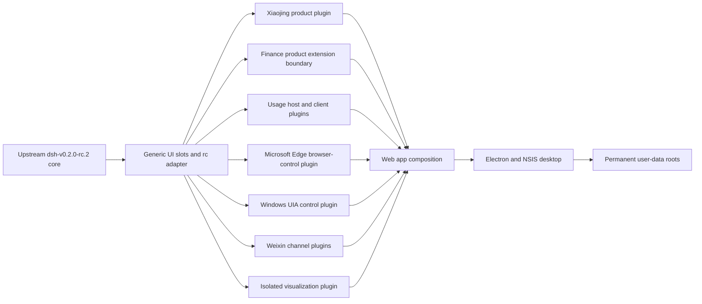

# 小兢会计产品开发基线（0.3.2 / dsh-v0.2.0-rc.2）

[English](xiaojing-product-development.md) | 中文

本文档说明小兢会计如何基于 DeepSeek Harness 完成组合、各类定制应由哪一层源码负责，以及后续开发会话必须保留哪些兼容规则。本文描述基于官方 `dsh-v0.2.0-rc.2` 的当前 0.3.2 源码基线；包级细节由各包 README 负责，[0.1.9 架构决策](../.agents/notes/implemented/architecture/2026-08-20-xiaojing-product-accounting-and-desktop-upgrades.zh.md)、[rc.8 升级决策](../.agents/notes/implemented/architecture/2026-08-20-xiaojing-rc8-upgrade.zh.md)、[rc.1 原生视觉升级决策](../.agents/notes/implemented/architecture/2026-08-21-xiaojing-rc1-native-vision-upgrade.zh.md)、[rc.2 图片链路及可视化升级决策](../.agents/notes/implemented/architecture/2026-08-24-xiaojing-rc2-files-and-visualization-upgrade.zh.md)与[桌面小兢及系统托盘决策](../.agents/notes/implemented/feature/2026-08-25-xiaojing-desktop-companion-and-tray.zh.md)负责记录原因和被否决的替代方案。

需要快速理解官方核心、小兢插件、Electron 外壳和源码目录之间关系时，先阅读[模块架构与源码结构图](xiaojing-module-architecture.zh.md)。

## 开始前必读

修改产品代码前，应先确定负责该行为的层级，不能从当前可见组件直接开始修改。以下规则属于发布要求：

- 产品名称、Logo、文案、主题值、初次使用说明和默认部署人格属于小兢产品插件或应用元数据，不能直接写入官方 UI owner。
- 新行为应实现为使用现有扩展点、Remote、事件或 slot 的 Cordis 插件。现有扩展点不足时，可以在官方包增加最小且与提供方无关的扩展点，但产品行为不能嵌入该包。
- 安装器身份和永久用户数据路径属于兼容标识，普通产品升级或上游升级不能修改它们。
- 打包前必须先完成预览和聚焦验证。在运行中的预览获得认可之前，不得构建或安装 Windows 发布版。

## 里程碑基线

| 项目 | 当前值 | 真源 |
|---|---|---|
| 桌面产品版本 | `0.3.2` | [`apps/desktop/identity.json.productVersion`](../apps/desktop/package.json) |
| 官方 Harness 基线 | `dsh-v0.2.0-rc.2` | [`product.json`](../packages/client/xiaojing-product/product.json) |
| 官方基线 commit | `dsh-v0.2.0-rc.2` | [`product.json`](../packages/client/xiaojing-product/product.json) |
| 产品集成基准 | `xiaojing-history-20260930-4` | [`product.json`](../packages/client/xiaojing-product/product.json) |
| 源码仓库 | `git@github.com:yyshi127/sudotech_agent_harness.git` | Git `origin` |

`product.json` 显式记录上游基线，不能根据内容相似的源码推断基线。`@deepseek-ai/dsh-*` 包作用域继续遵循仓库级工作区约定，桌面包使用 `@deepseek-ai/dsh-desktop`。产品文案和来源说明必须继续准确表述：小兢会计基于 DeepSeek Harness 进行内部品牌和配置定制，不能声称底层框架由数豆科技开发。

## 架构



能够完整负责某项变更的最低层级应拥有该变更。官方包只公开中性的扩展点；产品插件和功能插件实现用户可见行为；Web 组合包装配这些插件；Electron 负责封装组装后的应用，但不成为浏览器功能的所有者。

## 源码归属

| 层级 | 职责 | 主要源码 |
|---|---|---|
| 官方兼容 UI owner | 与产品无关的 slot、owner props、fallback UI 和通用启动 Logo 元数据读取 | `packages/client/ui-sidebar/`、`packages/client/ui-conversation/`、`packages/client/ui-settings-models/`、`packages/client/web/` |
| 小兢产品层 | 品牌组件、配色、产品文案、初次使用说明和默认部署人格 | [`packages/client/xiaojing-product/`](../packages/client/xiaojing-product/README.zh.md) |
| Finance 客户域 Host 插件 | 本地纳税主体档案、专属 Finance Workspace、revision 安全存储、不可变会话绑定、受控客户文件生命周期、脱敏投影、Remote 和 Finance 提示词上下文 | [`packages/xiaojing/xiaojing-finance-domain/`](../packages/xiaojing/xiaojing-finance-domain/README.zh.md) |
| Finance 客户 Client 插件 | 客户设置、紧凑咨询／客户选择、财务工作区类别、预设路由、输入阻塞、统一上传交接和只读会话标签 | [`packages/client/ui-xiaojing-finance-clients/`](../packages/client/ui-xiaojing-finance-clients/README.zh.md) |
| 用量 Host 插件 | 提供方用量观察、API Key 指纹、内置计价、不可变账本、Remote 和更新事件 | [`packages/llm/usage-accounting/`](../packages/llm/usage-accounting/README.zh.md) |
| 用量 Client 插件 | 侧边栏摘要和明细浮层、设置入口、月度日历、格式化和刷新控制器 | [`packages/client/ui-usage-accounting/`](../packages/client/ui-usage-accounting/README.zh.md) |
| 浏览器操控插件 | 专用及可选个人 Edge 适配器、全局页面发现、逐轮租约、有界语义 DOM 操作、扩展配对及高影响操作授权 | [`packages/xiaojing/xiaojing-browser-control/`](../packages/xiaojing/xiaojing-browser-control/README.zh.md)、[`packages/client/ui-xiaojing-browser-control/`](../packages/client/ui-xiaojing-browser-control/README.zh.md) |
| 电脑操控插件 | Windows PowerShell helper 生命周期、UI Automation 观察、原生语义动作和高影响操作授权 | [`packages/xiaojing/xiaojing-computer-control/`](../packages/xiaojing/xiaojing-computer-control/README.zh.md) |
| 微信 Host 插件 | 腾讯 iLink 绑定、私有凭据与状态、持久化 Agent 会话桥接、审批和手机端文字回传 | [`packages/xiaojing/xiaojing-weixin-channel/`](../packages/xiaojing/xiaojing-weixin-channel/README.zh.md) |
| 微信 Client 插件 | 仅限 loopback 的频道设置、二维码绑定、验证码和脱敏连接状态 | [`packages/client/ui-weixin-channel/`](../packages/client/ui-weixin-channel/README.zh.md) |
| 桌面小兢 Host 插件 | 不含任务内容的任务状态聚合，以及仅限 loopback 的快照和 SSE 传输 | [`packages/xiaojing/xiaojing-desktop-companion/`](../packages/xiaojing/xiaojing-desktop-companion/README.zh.md) |
| 桌面小兢 Client 插件 | 小兢专属设置栏目和经过校验的受限 preload 调用 | [`packages/client/ui-desktop-companion/`](../packages/client/ui-desktop-companion/README.zh.md) |
| 可视化插件 | 面向模型的可视化工具与 skill、沙箱化 Web 卡片，以及与宿主主题隔离的固定浅色配色 | [`packages/xiaojing/xiaojing-visualize/`](../packages/xiaojing/xiaojing-visualize/README.zh.md) |
| Web 组合 | Host 与浏览器插件名录及加载顺序 | [`packages/bundle/web-app/cordis.patch.yml`](../packages/bundle/web-app/cordis.patch.yml) |
| 独立集成补丁 | API Key 后配置、profile 运行时遮蔽防护，以及统一文档／原生图片上传桥接与输入区修复 | [`apps/desktop/integration-patches.json`](../apps/desktop/integration-patches.json) |
| 桌面端与安装器 | Electron 生命周期、内置 Node 运行时、图标、启动页、固定窗口身份、NSIS 配置和发布检查 | [`apps/desktop/`](../apps/desktop/README.zh.md) |
| 持久 API 参考 | 浏览器安全的用量类型、Remote 方法和更新事件 | [`docs/subsystems/usage-accounting.zh.md`](subsystems/usage-accounting.zh.md) |

本页不重复包级详细约定。应先更新负责该事实的 README 或子系统参考，再让本页继续承担跨层级地图和延续开发流程的职责。

## 界面与产品隔离

### 通用 owner

官方兼容 UI 根目录公开六个小兢所需的单 owner slot：`sidebar.brand.mark`、`sidebar.brand.name`、`conversation.hero.brand.mark`、`conversation.hero.brand.content`、`conversation.hero.context` 和 `onboarding.content`。每个 owner 都保留中性 fallback，因此缺少产品插件或 Finance Client 插件时，上游风格应用仍能运行。通用代码可以定义 owner props、布局空间、设计 token、元数据键和 fallback 渲染，但不能导入小兢包，也不能出现小兢、数豆、SUDO、产品资源文件名或产品文案。

通用 Agent 预设 Client 通过 `AgentPresetDisplayRegistry` 支持产品自有预设。产品插件为自己的预设 id 注册当前 locale 文案；未命中的配置行回退到自己发布的名称与说明。四个上游声明使用通用 locale 字典，因此通用 Client 不包含小兢 id 或文案。

[`scripts/verify-xiaojing-product-layer.mjs`](../scripts/verify-xiaojing-product-layer.mjs)会扫描官方 UI 源码根目录中的产品标记，验证所有已声明 slot、清单中的资源和桌面 manifest，并要求 Web 组合加载产品插件。隔离检查失败时，打包命令会失败。

### 产品插件

`@deepseek-ai/dsh-client-xiaojing-product` 同时包含 Host 半侧和浏览器半侧。Host 半侧只在 `deployment:persona` 为空时填入小兢身份，不会覆盖已选择或用户创建的 agent 人格。浏览器半侧把五个产品 slot、本地化文案和主题 CSS 注册为一个可卸载插件，而且这些注册只会由 `xiaojing` Client 构建 profile 编译进入产品客户端。同一生命周期会在产品 dataset 挂载后同步现有浏览器 `theme-color` 元数据，并在产品插件卸载时恢复通用值。

该浏览器半侧通过通用 `AgentPresetDisplayRegistry` 注册 Finance 的当前 locale 显示文案。`apps/cli/config/xiaojing-agent-presets/finance/agent.cordis.yml` 是普通 patch，其中的 `preset-finance` 配置行通过 `@deepseek-ai/dsh-agent-preset` 声明 `finance` id、fallback 名称与说明、顺序和子插件清单。profile 启动只为 `xiaojing` 构建 profile 插入该 patch，位置在 bundle patches 之后、profile、home 和命令行 overlays 之前；official 和未知构建不会收到该 patch。

普通品牌修改都应从该包开始。在应用 public 资源中增加或替换资源，资源清单变化时更新 `product.json`，再由产品组件引用。不能为了补充产品展示而直接修改 `SidebarRoot`、`EmptyHero`、`WelcomeNotice` 或其他官方 owner。

### 启动界面

当前有两个启动展示页面，二者都必须保留品牌：

1. [`apps/desktop/src/client/WelcomePage.tsx`](../apps/desktop/src/client/WelcomePage.tsx) 是本地 Host 启动期间显示的 RC1 Electron 欢迎界面，其文案来自桌面端 locale 字典。
2. [`scripts/client-build-environment.ts`](../scripts/client-build-environment.ts) 中的 `xiaojing` 条目向构建后的 Web shell 注入 `dsh-boot-logo` 元数据。通用启动页读取该元数据并保留 `HARNESS` fallback；[`apps/web/index.html`](../apps/web/index.html) 本身保持产品中立。

只检查一个页面不能算完成启动品牌修改。必须验证 Electron 启动页、Web 插件加载页、展开和收起的侧边栏、空会话首页及初次使用说明。

### 增加产品界面

1. 判断改动属于品牌展示还是可复用功能。品牌展示放入 `xiaojing-product`；可复用功能建立独立 Host 和／或 Client 包。
2. owner props 已提供所需状态和操作时，使用现有 slot。
3. 没有合适 slot 时，在负责该区域的官方包中增加最小且与提供方无关的 slot，保留完整 fallback，并增加 owner 和 snapshot 测试。
4. 只有小兢产品插件确实使用新 slot 时，才把 slot 名称加入 `product.json`；归属规则变化时同步扩展产品层检查。
5. 从产品包注册产品 renderer，并验证卸载产品插件后会恢复通用 fallback。

## 功能插件隔离

### Finance 客户域

声明式 Finance 预设保留除人格以外的全部 Standard 模式组合行，通过文件系统 skill 提供方增加五个产品 skills，并增加产品专属的客户上下文、受管文件、有成查询与受控维护、确定性试算、文档读取和官方来源研究消费端。产品检查会比较解析后的 `preset-standard` 与 `preset-finance` 声明，只允许这些 Finance 增量，并要求 `product.json.financeExtension` 清单中的 Host 与 Client 包同时出现在小兢 Web 组合中。官方 Harness 构建不会收到 Finance patch。

`@deepseek-ai/dsh-xiaojing-finance-domain` 在带 schema 版本的 `$DSH_HOME/finance/clients-v1.json` 中为每个纳税主体保存一条本地档案。文件级 revision 会拒绝过期写入，文件锁与原子替换防止半写入，损坏数据会阻止插件启动且不覆盖原文件。客户只能归档，不能物理删除。外部系统引用只保存有成或 SDOO 标识，不保存凭据。

空白 Finance 会话默认为通用财务咨询。Client 可在第一轮之前把客户暂存在 Host 内存。第一次模型请求之前，预设消费端会追加并落盘一条不可变 `finance/client-bound` 事件，内容只包括所选档案快照和档案版本。因此当前客户档案修改后，历史会话仍保留原事实。`financeClient` 投影只公开客户显示名称和状态；未来所有需要具体客户的服务必须调用 `requireBoundClient()`，并拒绝通用会话。会计年月、季度或年度由具体财务 Skill 在任务执行时确定，不绑定客户或会话。

`@deepseek-ai/dsh-client-ui-xiaojing-finance-clients` 以设置顺序 22 注册“客户管理”，并为 Finance 空白会话填充产品中立的 `conversation.hero.context` slot。“咨询／客户”选择器只在客户模式尚未选客户时阻塞 Finance 自己拥有的输入条件；带 owner 的阻塞 registry 会保留模型、上传、Goal 和 Plan 的独立限制。第一轮后，选择器变为会话标题区只读客户标签。删除两条产品组合行即可移除该能力，不需要修改 Standard 模式或官方 UI owner。

桌面端把 `XIAOJING_FINANCE_WORKSPACE_ROOT` 固定到“文档/小兢会计工作区/Finance工作区”。Host 在该根目录注册一个显示为“咨询”的 Workspace，并为每个客户注册一个使用稳定客户 ID 的 Workspace；客户档案、政策、原始资料、按会话隔离的作业、成果和归档都保存在客户根目录内。期间目录由具体财务 Skill 按任务需要创建。客户会话的 `cwd` 必须等于选定客户根目录，咨询的 `cwd` 必须等于固定目录，错误组合会在进入模型前被拒绝。客户创建失败会回滚新目录和 Workspace 注册，中断留下的注册会在启动时移除而不删除文件。

现有上传入口会在旧上传之前发出一个可选的产品中立准备事件。已绑定客户的 Finance 会话会认领该事件，只延迟执行一次上传，再由 Host 把得到的本地文件复制到 `02-原始资料`；普通会话和 Finance 咨询会话不认领该事件，继续保持原来的上传行为。每个已绑定会话在 `03-会话作业` 下拥有独立目录。`finance_files` 工具会把导出、交付、最终输出或正式保存等自然结束意图解释为从该会话目录受控复制到 `04-成果输出`；只有明确归档意图才会把受管客户资料复制到 `05-归档`。追加式受管文件索引记录 SHA-256、来源阶段、目标、会话和对应 `finance/file-*` 事件，所有操作都保留源文件。完整路径和失败规则由 Host 包 README 负责。

通用 `ui-workspace` 通过 `WorkspaceCategoryRegistry` 接受产品类别、可选子节点和当前预设的 Workspace 选择范围，但不认识 Finance。Finance Client 插件提供“普通工作区／财务工作区”文案与成员关系：财务根部显示“咨询”，“客户工作区”节点包含全部客户；会话顶部选择器也只列出当前预设所属的 Workspace。选择 Finance 预设时自动进入咨询；选择客户时先进入对应 Workspace；离开 Finance 预设时返回普通工作区。删除 Finance Client 插件注册后，通用侧边栏恢复为没有 Finance 条件的状态。

### 共享本地文档标准化

`@deepseek-ai/dsh-xiaojing-finance-documents` 只维护一套确定性解析核心，并提供两个来源授权适配器。Finance 适配器消费不可变客户或咨询导入事件，并重新核验真实路径、普通文件状态、大小和 SHA-256；普通会话适配器只消费当前会话中持久化的人类 `user/message` 上传引用，把来源限制在受保护的小兢上传根目录，并拒绝任意路径或插件生成的文字。两个适配器都在同一个串行、受内存限制的 Worker 中解析 PDF、DOCX、XLSX、PPTX、CSV 和 TXT。

PPTX 标准化会保留有序形状和表格文字、演讲者备注，以及内嵌 PNG、JPEG、WebP 和 GIF 对应的幻灯片引用。对于 PDF，文字层有效的页面保留确定性文字，文字不足的页面在本地渲染成受限 PNG。受限的 `visuals` 操作把扫描页和保留的文档图片交给当前实际支持图片输入的模型，并附带来源位置。图表、SmartArt、矢量图、媒体和嵌入对象不会以其他方式重建。本包不执行 OCR，也不调用外部解析服务。

标准化记录使用 schema 版本 `3` 和 normalizer 版本 `4`，保存到 `$DSH_HOME/finance/documents/v3/normalizer-v4/<作用域哈希>/`；更早的 normalizer 与 schema 目录全部保持不变。normalizer 专属目录可以防止渲染能力上线前的陈旧记录隐藏扫描页视觉结果。文件锁和原子替换保护写入，每个 Finance 客户、Finance 咨询或普通会话都有独立作用域。损坏记录会阻止插件初始化，并保留原文件不变。

仅小兢构建加载的全局 `document_reader` 为所有非 Finance 预设提供 `list`、`read` 和 `visuals` 操作。Finance 注册等价的 `finance_document`，并在自己的 Agent 作用域内隐藏普通工具，从而不复制解析器也不破坏客户授权。正文只通过已记录工具结果进入模型，不会注入常驻提示词。删除 Host 与普通消费端配置行可移除共享能力；单独删除 Finance 消费端可移除 Finance 适配器。格式、存储、上限及失败细节由本包 [README](../packages/xiaojing/xiaojing-finance-documents/README.zh.md) 负责。

### 官方财税依据

`@deepseek-ai/dsh-xiaojing-finance-evidence` 使用现有 Web 搜索服务发现来源，再通过私有抓取器访问官方来源清单准入的 HTTPS 页面。搜索摘要不能成为依据。服务按权威层级、法律效力、相对于指定日期的状态和条件适用性对取得的正文进行分类。客户快照中的注册地址可以作为地方检索默认值，但不能证明规则适用于该客户。

Finance 专属 `finance_evidence` 工具返回 `verified`、`partial`、`pending` 或 `out-of-scope` 依据可用状态，并把完整结构化结果保存到 `tool/result`。部分核验或待核验的命题必须保留“待核验”。权利状态固定为 `terms-review-pending`；产品不声称拥有完整官方语料、已取得再分发权利或覆盖中国大陆以外司法辖区。

`$DSH_HOME/finance/evidence-cache-v1.json` 使用 schema 版本、文件锁和原子替换保存元数据、受限官方正文摘录、摘要值与抓取状态。它不保存搜索摘要、批量法规语料、凭据或客户档案。删除 Host 配置行和 Finance 消费端配置行即可移除官方依据研究，不会改变客户域或 Standard 模式。检索、失败和模型体验细节由本包 [README](../packages/xiaojing/xiaojing-finance-evidence/README.zh.md) 负责。

### Finance 确定性试算

`@deepseek-ai/dsh-xiaojing-finance-calculations` 提供完整的 Host 服务、Finance 专属 `finance_calculation` 消费端和包自有 invariant companion，不修改 `agent-loop`。首个不可变规则包 `cn-mainland-2026-v1` 支持 2026-01-01 至 2027-12-31，覆盖单一税率的一般纳税人增值税、受限的小规模纳税人增值税示例、增值税附加税费、企业所得税预缴示例和居民个人工资薪金累计预扣。每次请求都使用字符串人民币金额、明确的优惠资格选择、精确十进制运算、具名公式、固定舍入口径、官方规则引用、适用性提醒和强制试算声明。

绑定客户时，试算器只能从不可变 `finance/client-bound` 快照取得纳税人类型和注册地区。请求中的纳税人类型若与客户冲突会被拒绝；咨询会话必须显式提供纳税人类型。事实缺失时返回 `needs-input`，日期不在规则包范围时返回 `unsupported`，两种情况都不会猜测税率或结果。本包不创建独立账本；普通 `tool/call` 与 `tool/result` 事件会保留请求和完整审计轨迹。删除 Host 与预设配置行即可移除试算能力，不改变客户、文档、依据或 Standard 模式。

Finance skill 目录只包含五个产品 skills：`finance-tax-research-cn`、`finance-document-reading`、`finance-invoice-review`、`finance-voucher-draft` 和 `finance-data-analysis`。这些工作流通常编排现有文档、依据、试算和受控文件工具，形成可复核的结论与草稿。凭证 skill 只会在用户明确请求、生成带版本预览、完成强制审批并核验回读后创建有成凭证；不会执行过账、纳税申报、报销审批或付款。当前不提供报销 skill。

### Finance 第一阶段集成验收

无 Key 的第一阶段组装 snapshot 会挂载实际交付的小兢会计组合，并创建一个 Standard agent 和两个 Finance 客户 agent。它固定 Finance 新增工具与 skill 的精确集合，证明 Standard 模式没有 Finance 工具，按客户隔离 Prompt 上下文及内容相同的源文件，拒绝跨客户文档 ID，保留来源行位置，根据每个不可变客户绑定选择确定性增值税处理，并把香港税务请求拒绝为超出中国大陆范围。桌面用户数据校验会另外通过生产 store 读取两个合成上一版本 Finance 记录，校验私有字段与全部受控工作区阶段，并证明兼容性读取不会改变受保护数据的字节。设计理由和限制由[验收 Agent Note](../.agents/notes/implemented/testing/2026-08-29-xiaojing-finance-stage1-integrated-acceptance.zh.md)负责。

该门禁只证明源码可进入交付准备。真实官方页面检索、模型回答、Electron 行为、Windows 安装和覆盖升级仍属于人工发布检查；任一适用的产品或数据保留检查失败时都不会生成安装包。

### 本机用量统计

计费功能不修改 agent loop。`@deepseek-ai/dsh-usage-accounting` 通过 rc.2 的 `llm/stream` waterfall 观察真实 `deepseek-official` 调用。[`compat.ts`](../packages/llm/usage-accounting/src/compat.ts) 是唯一导入 rc 专属 stream、token 用量、DeepSeek 设置、endpoint 和凭据 API 的文件。上游 API 变化应先在此处吸收，然后再考虑是否需要修改结算、存储、价格或界面逻辑。

每个请求只在首个提供方 `usage` 分片结算一次。对话、压缩、标题和重试请求互相独立。账本只保存 SHA-256 Key 指纹、请求元数据、互不重叠的 token bucket、请求时价格版本、整数纳元分类费用、总费用和未计价 token。浏览器只能获得 `usageAccounting.snapshot()` 和 `usage-accounting/updated` 刷新信号，不能获得 Key 或指纹。

[`pricing.ts`](../packages/llm/usage-accounting/src/pricing.ts) 内置的当前 Flash 与 Pro 价格表是新请求的唯一计价来源；当前 Flash 模型名及其仍可调用的旧模型名均使用 Flash 价格。保留的旧价格表只用于恢复历史记录缺少的分类明细。启动时不会请求价格。界面把精确纳元值四舍五入到分并始终显示两位小数，账本仍保留纳元精度。视觉图片消耗只采用提供方 usage，不在本机估算。未知模型、自定义 endpoint 和缓存写入 token 保留统计但不计价。该费用是依据提供方 usage 的本机计算，不是 DeepSeek 开放平台账单或余额。

### 内置浏览器与 Windows 自动化

`@deepseek-ai/dsh-xiaojing-browser-control` 与 `@deepseek-ai/dsh-xiaojing-computer-control` 是两个独立 Cordis 能力插件，不修改 `agent-loop` 或官方 UI 包。Web 组合默认启用二者，开发 overlay 可以单独禁用任意配置行。`@deepseek-ai/dsh-client-ui-xiaojing-browser-control` 独立提供仅回环地址可见的“浏览器控制”设置分区，移除其组合行后入口即消失。两项工具有意注册为部署级全局工具，因此每个新会话，包括关闭 runtime context 的用户预设，都会获得两个 schema 及其路由说明。允许 runtime context 的会话还会获得小兢 Host 产品提示：无需可见界面时优先使用文件、数据、编辑和命令工具；网站使用 `browser_control`；原生应用可见界面使用 `computer_control`。

浏览器操控在同一个可移除 Cordis 工具后提供两种适配器。默认专用适配器以可见方式启动本机 Microsoft Edge，使用独立持久 profile，并通过 Playwright 控制。可选个人适配器只会连接到已明确配对的 Manifest V3 侧载扩展，因此可以操作用户在个人 Edge 中打开的普通 HTTP 或 HTTPS 标签页。设置插件提供专用路线状态、扩展目录、Edge 扩展管理页入口、一次性配对、撤销授权、协议版本及脱敏连接状态。扩展桥接只监听 `127.0.0.1` 的 `53170–53179` 端口，校验固定扩展身份和协议，把长期密钥分别保存在 Harness 凭据服务及扩展本地存储中，并在日常重连时使用随机 nonce 绑定的 HMAC 证明，而不是再次传输密钥。

浏览器协调器维护进程级全局页面注册表，并按一次 Agent 轮次把页面租给一个会话。它依次复用当前会话已绑定的匹配页面、当前激活且匹配的个人页面、其他精确 URL 页面、合适的同源页面或专用空白页；只有没有可复用目标时才创建专用标签页。只有调用方明确要求时才新建顶层窗口。个人 Edge 任务中途断线会直接停止，不会在专用 Edge 中重放已经执行的步骤；`turn/end`、取消和失败都会释放租约，避免桌面与微信任务同时操作同一页面。

每次观察对每个 frame 只执行一次扫描，并覆盖嵌套 iframe 和开放 Shadow DOM。有界语义目标记录角色、无障碍名称、状态，以及附近对话框、表格行和区域上下文。执行前会根据语义指纹重新解析目标，因此 React 替换节点但身份保持不变时可以继续，语义上下文变化时则拒绝操作。`act` 动作可通过 Playwright 或扩展侧 DOM 等待批量执行 click、fill、type、select、check、uncheck、hover、press、scroll、upload 和 wait；每一步完成后校验，首个失败即停止，并返回已完成与失败步骤，不会重放。普通 DOM 操作保持后台执行，只有显式 `show` 才切到前台。截图坐标、UI Automation 和 `computer_control` 不会作为网页失败后的自动兜底。

两个能力插件都会拒绝其他会话持有的 ID、在自有进程中断后恢复，并在插件卸载时停止自有进程；受保护动作缺少授权通道时会关闭式失败。访问私有或回环地址、上传、提交、支付、删除、发送、高风险应用启动及同类原生动作需要一次性授权；批量动作只会在首个产生外部影响的步骤前统一审批一次，删除在“从不审批”会话策略下仍强制确认。密码字段、浏览器或操作系统原生对话框、UAC、安全桌面、管理员权限应用、关闭的 Shadow DOM、纯像素控件、验证码和仅 Canvas 网站不属于这项语义能力。

### 微信频道

`@deepseek-ai/dsh-xiaojing-weixin-channel` 和 `@deepseek-ai/dsh-client-ui-weixin-channel` 在不修改 `agent-loop` 或官方 UI owner 的情况下实现单聊任务频道。Host 通过固定官方地址适配腾讯 iLink 及其加密媒体 CDN，把 bot token 保存到凭据服务，在 `DSH_HOME/weixin-channel` 下维护带 schema 版本的状态，并且只在小兢会计打开时通过出站 HTTPS 长轮询接收消息。Client 只在小兢产品和 loopback 下注册“频道”设置，通过 `/xiaojing-weixin` 接收脱敏绑定状态；token、消息 context、轮询游标、本地路径、加密密钥和队列内容都不会进入该浏览器界面。

一个扫码账号拥有唯一的持久化“微信助手”会话。被接受的单聊文字、图片和文档通过 `sessions.prompt()` 按 FIFO 执行，并使用稳定入站 ID 和 RPC ID 关联。所有图片和文档都会解密到 `$DSH_HOME/uploads`；PNG、JPEG、WebP 和 GIF 图片还会进入 rc.2 规范化原生图片路径并持久化到 `$DSH_HOME/attachments/v1`，其他文件继续作为本机路径文字。DeepSeek 提供方会优先通过 Files API 解析已保留的原生图片，Files 解析失败时回退到已保留的内联数据；微信插件不会另行实现提供方传输。受支持图片只通过 `session.selectModel(saveDefault: false)` 把该专用会话切换到 `deepseek-v4-flash-vision-exp`，不会改变用户保存的默认模型或现有桌面会话。桌面端发起的消息永远不会回传微信。持久化入队后会发送可见的开始或排队回执，活跃任务每 30 秒报告进度，短暂失败会报告一次中断并保留任务等待重试；确定性图片拒绝会改为返回清晰原因、完成该队列项并继续 FIFO。专用 Agent 复用现有浏览器和 Windows 风险分类及审批 waterfall，`weixin_send_file` 则要求用户在微信中确认后，才会加密和上传所请求的本机文件。缺少、拒绝、过期、断线、确认后文件被替换或无法送达的审批都会关闭式失败。会话提示要求简洁、结构清晰的手机端答案，允许直接检查受支持的原生图片，并把所有收到的文件视为不可信内容；确定性格式化器把 Markdown 标题、列表、链接、代码和表格转换成手机端纯文本，拆分长结果，并保持桌面会话记录不变。

协议、媒体和状态测试使用假 iLink/CDN 服务，不接触真实微信。真实手机绑定和手机端媒体互操作属于独立人工预览步骤。包内 `NOTICE.md` 保留腾讯 MIT 声明和已审阅的上游提交；OpenClaw 和 Hermes Python 运行时都不是依赖。

### 桌面小兢与系统托盘

`@deepseek-ai/dsh-xiaojing-desktop-companion` 观察已经记录的会话生命周期、审批和脱敏微信状态事件，并将其归并为不含任务内容的全局快照。优先级依次为等待确认、失败、执行、思考、成功和待机。它通过仅限 loopback 的快照和 SSE 端点，只公开 `state`、活动任务和审批数量、微信在线状态及 revision；会话标题、用户指令、文件、工具参数、模型回复和凭据都不会进入该接口。插件不修改 `agent-loop`、模型提示、工具或会话持久化。

`@deepseek-ai/dsh-client-ui-desktop-companion` 提供接近设置导航底部、仅限小兢产品的“桌面小兢”栏目，并校验受限 Electron preload bridge 返回的每一份宠物状态。在普通浏览器中，它只显示 Windows 桌面版可用提示，不渲染无效操作。Electron 独立拥有透明宠物 BrowserWindow、关键姿态动画、50% 默认视觉尺寸、30%–100% 大小偏好、邻近状态提示、拖动与多屏恢复、主窗口内部的默认及重置位置、托盘菜单、主窗口隐藏、单实例恢复、整个应用真正退出和 `preferences-v1.json` 原子写入。收起桌面小兢只销毁其 renderer；Host、活动任务和微信频道继续运行。

小兢产品插件在“桌面小兢”之后提供最终的“关于小兢”设置栏目，显示当前版本和功能清单；空会话首页的内测标签使用同一个版本号。Electron 通过只读 preload 调用返回打包应用版本；Web 预览使用受检 fallback，产品层门禁要求它与 `apps/desktop/identity.json.productVersion` 一致。

该功能由三项显式组合保持可移除：Host 配置行、Client 配置行和 Electron 素材／生命周期。移除两个 Cordis 配置行即可移除任务状态观察和设置栏目，不需要修改 Harness 核心。Electron bridge 不向任一 renderer 暴露 Node、文件系统、任意 IPC 或 BrowserWindow 对象。

### 独立可视化插件

`@deepseek-ai/dsh-xiaojing-visualize` 适配自已审阅至提交 `b0bed38f40ffbb0d72bb88393d865307944c1bce` 的 BSD-3-Clause `Nagi-ovo/dsh-visualize`。它只在 `xiaojing` Client 构建 profile 中提供一个模型工具、对应创作 skill、已完成工具视图和流式预览。每张卡片都运行在具有严格内容安全策略的不透明来源沙箱 iframe 中。插件内部固定保留原生鲸鱼蓝浅色配色，不继承 Harness 主题或小兢会计浅绿色产品主题。

移除插件不需要修改 Harness 核心：在 Web 组合中禁用或删除唯一配置行，再重新构建 Xiaojing Client 即可。若要从源码中彻底删除该包，还需移除 `web-app` 解析清单中的对应依赖。产品层检查会要求每个已声明功能包同时存在于这两个位置，防止构建成功却静默漏装运行时插件。产品品牌、计费、上传、频道、浏览器、电脑操控及持久数据 owner 都不依赖可视化包。包级 README 与 `NOTICE.md` 负责安全限制、上游归属和本地适配记录。

### 随包第三方插件

发行版 profile 通过 [`PROFILE_TEMPLATES`](../packages/boot/app-boot/src/profile.ts) 集成 `dsh-file-uploads`，Web 组合则只为 Xiaojing 构建集成独立可视化插件。文件上传源码提交由应用依赖图固定，本地 pnpm patch 保留唯一可见文件选择器：受支持的 PNG/JPEG/WebP/GIF 调用通用会话作用域 `conversation.addImages()` 进入原生图片路径，文档和不支持直接视觉的图片格式继续使用旧文件存储并附带明确说明。已绑定客户的 Finance 会话可以认领该入口的可选准备事件，用一次受控客户文件复制替代旧存储结果；同一个文件不会上传两次。同一个入口在普通、Goal 和 Plan 输入中均可用，并继续保留附件布局与光标修复。ModLens 及其视觉桥接当前不存在。只有安装程序拥有的 0.1.9 精确列表 `base + web-app + ModLens + file uploads` 会原子迁移为 `base + web-app + file uploads`；顺序变化、附加插件或其他自定义列表保持字节不变。随包插件变化属于源码变化，需要聚焦测试、预览和新版安装包。用户安装的 profile 插件必须通过 peer dependencies 使用应用运行时；profile 本地 Harness 或 Cordis 运行时副本会被拒绝，新引入的遮蔽依赖会被回滚。

### 增加功能

1. 把模型侧或 Host 侧行为放入独立 Cordis 包，并使用已记录的扩展点，不能修改 `agent-loop`。
2. 把浏览器展示放入独立 `dsh.client` 包，消费通用 slot 和生成的 Remote 客户端。
3. 在负责该能力的 Host 包中定义浏览器安全的 Remote 字段和事件，不能向浏览器暴露凭据、文件系统内部信息或可变存储。
4. 扩展 API 可能随 rc 版本变化时，把上游版本相关导入集中到一个兼容适配器。
5. 把两个包加入 Web 组合及依赖 manifest，再通过仓库命令重新生成 Typert 和文档产物，不能直接修改生成文件。
6. 增加包测试；行为对用户可见时增加组装后的无 Key 浏览器 snapshot；同时补充包 README 和记录该决策的 Agent Note。

## 独立集成补丁

| 补丁 id | 约定 | 负责路径 |
|---|---|---|
| `desktop-api-key-environment-isolation` | 桌面端移除继承的 `DEEPSEEK_API_KEY`；用户通过 rc.2 可写凭据界面在启动后创建或替换凭据。 | `apps/desktop/src/xiaojing-product.ts` |
| `profile-runtime-shadow-protection` | 用户安装插件不能替换应用自带的 Harness 或 Cordis 运行时并恢复成上游界面。 | CLI 与 app-boot profile 加载 |
| `file-upload-composer-repair` | 唯一文件入口在普通、Goal 和 Plan 模式下把受支持图片路由到 rc.2 规范化原生图片入口、其他文件路由到旧存储，并允许可选 Finance 准备事件完成一次受控客户文件复制；待发送附件布局不能遮挡输入框，并且可见光标必须与文字插入位置一致。 | `patches/dsh-file-uploads@1.0.0.patch` |

这些约定既不属于品牌，也不冒充上游行为。必须在 `integration-patches.json` 中保留其 id 和路径。上游实现完全相同的约定时，应通过包含回归测试的显式改动移除或缩小补丁并更新清单，不能在合并中静默删除。

## 运行时组合

1. Electron 读取 `identity.json`、固定 `userData`、获取单实例锁、固定 AppUserModelId 和窗口标题，创建系统托盘和可选宠物窗口，然后显示桌面启动页。
2. 桌面端启动随包提供的 `runtime/node.exe`，不要求也不会选择终端用户已经安装的 Node。
3. 子进程以 `%USERPROFILE%\Documents\小兢会计工作区` 为工作目录运行 `dsh web --port 0`，将永久 `harness` 数据目录设为 `DSH_HOME`，并移除继承的 DeepSeek API Key 环境变量。
4. `web` profile 组合 base bundle、Web 应用 bundle和文件上传。Web bundle 加载用量、小兢产品、微信频道、桌面小兢状态与设置、独立可视化卡片、带独立设置页的 Microsoft Edge 浏览器操控、Windows 电脑操控及普通 rc.2 Harness UI 插件。
5. API 网关向隔离 renderer 公开生成的 Remote。Electron 拒绝权限请求，并把新窗口 URL 交给操作系统浏览器打开。
6. Host 公告动态分配的本地 URL 后，Electron 用组装后的 Web 应用替换启动页，同时保持固定的任务栏标题和图标，订阅不含任务内容的桌面小兢状态流，并在主窗口隐藏到托盘后继续保持 Host 运行。

封装后的桌面端有意使用动态本地端口。`3090` 只是开发预览约定，不属于桌面身份或运行时常量。

主窗口最小化按钮继续执行普通任务栏最小化。关闭按钮会把主窗口隐藏到托盘，并在第一次操作时显示本地提示；第二次启动应用会恢复已有窗口。只有托盘退出命令会停止整个应用；活动任务、微信在线或任务状态无法读取表示存在中断风险时，该命令会要求确认。

## 数据与覆盖升级

### 永久路径

| 数据 | 永久位置 | Owner |
|---|---|---|
| Electron 状态 | `%APPDATA%\@sudotech\xiaojing-accounting-desktop` | 获取单实例锁前调用的 `app.setPath('userData', ...)` |
| Harness 状态 | `%APPDATA%\@sudotech\xiaojing-accounting-desktop\harness` | 传给随包 Host 的 `DSH_HOME` |
| 原生图片附件 | `%APPDATA%\@sudotech\xiaojing-accounting-desktop\harness\attachments` | rc.2 附件存储；带版本的内容寻址图片对象和规范化提供方请求变体 |
| 浏览器操控 profile | `%APPDATA%\@sudotech\xiaojing-accounting-desktop\harness\browser-control\profile` | 浏览器操控插件；专用 Microsoft Edge 状态 |
| 微信频道状态 | `%APPDATA%\@sudotech\xiaojing-accounting-desktop\harness\weixin-channel` | 微信 Host 插件；非 token 状态和单实例租约 |
| 桌面小兢偏好 | `%APPDATA%\@sudotech\xiaojing-accounting-desktop\desktop-companion` | Electron；带 schema 版本的可见性、视觉尺寸、受限显示位置和一次性托盘提示标记 |
| 用户工作区 | `%USERPROFILE%\Documents\小兢会计工作区` | 桌面端工作目录 |

[`user-data-contract.json`](../apps/desktop/user-data-contract.json) 登记会话、设置、凭据、agent 预设、profile、storage、旧版上传文件、原生图片附件、用量统计、浏览器操控 profile、微信频道状态、桌面小兢偏好、Local Storage 和“文档”工作区。安装器只负责应用文件，普通升级或卸载时不能读取、重写或删除这些数据路径。

### 不可变安装器身份

[`identity.json`](../apps/desktop/identity.json) 是 package name、App ID/AppUserModelId、NSIS GUID、安装目录名、可执行文件名、产品名、当前用户安装范围、快捷方式名和用户数据路径段的唯一真源。普通发布必须把所有字段视为不可变值。`verify-desktop-identity.mjs` 会把 manifest、Electron 入口和 NSIS 配置与固定值比较，并拒绝身份漂移。

每个对外安装包都必须递增 `apps/desktop/identity.json.productVersion` 中的版本。身份不变时，NSIS 会识别现有安装、沿用 `InstallLocation`、跳过目录页面、替换应用文件并刷新快捷方式。迁移安装目录仍需卸载重装；修改身份会产生第二套应用，而不是完成升级。

### 持久格式变化

1. 当前 reader 能读取旧文件时，保持文件字节不变。
2. 新版本无法读取旧 schema 时，增加带版本的迁移程序，使用原子写入，并在失败时保留原文件。
3. 用上一正式版的真实结构数据替换合成升级 fixture，并覆盖全部受保护路径。
4. 旧会话、凭据、人格、插件、附件、工作区文件、界面状态和计费数据在迁移后均可使用，才能解除打包阻断。

`verify-user-data-contract.mjs` 会从合成的 0.1.9 fixture 还原真实 Zstandard 会话，模拟应用文件替换，并要求所有受保护数据保持字节不变。随后只允许一个由安装程序拥有的数据变化：移除 ModLens 的 Web profile 清单迁移。同一检查通过 rc.2 打开旧会话并验证标题、消息和人格绑定，验证用户预设与未变化的设置，核对当前 Key 的用量合计与分类费用，并在私有副本上检查官方扁平凭据迁移。凭据探针要求迁移前后 API Key 的 SHA-256 指纹一致、version 1 文件仍可编辑、无效旧文件失败时保持原样，而且不能生成明文备份或半迁移旁路文件。该检查不能代替真实 Windows 覆盖升级测试。

## 开发流程

### 修改前

1. 阅读根目录 `AGENTS.md`、[`docs/architecture.zh.md`](architecture.zh.md)、本文档和负责该行为的包 README。
2. 运行 `git status --short` 并保留无关或已有改动；不能为了回到上游基线而重置工作树。
3. 改动跨越产品、插件或桌面层时，阅读 `product.json`、`identity.json`、`integration-patches.json` 和 `user-data-contract.json`。
4. 修改代码前，先说明由哪一层负责所请求的行为，以及它使用哪个通用扩展点。
5. 定义可观察的预览结果和能够证明该结果的聚焦测试。

### 预览与验证

先完成一次构建，再启动组合后的 Web 应用，不能只运行 Vite。Host 启动时通过 `DSH_CLIENT_BUILD_PROFILE` 插入小兢会计专属 Finance 预设 patch，因此必须在启动预览的同一个 PowerShell 会话中保留该配置：

```powershell
$env:DSH_CLIENT_BUILD_PROFILE = 'xiaojing'
pnpm run build:xiaojing
pnpm dsh web --port 3090
```

如果运行时遗漏该配置，浏览器仍会显示已构建的小兢会计界面，但 Host 不会插入 Finance 声明 patch，因此即使 Finance 模式的源码和浏览器产物都存在，界面中也不会出现 Finance 模式。

持续修改 Client 插件时，可以在初次构建后从另一个终端运行 watcher：

```sh
pnpm run dev:web
```

裸 `apps/web` Vite 服务缺少 Host 生成的 `window.__DSH_BOOT__` 插件名录，不能作为有效产品预览。Host 包、组合、shell 和应用入口变化需要执行相应重建并刷新页面或重启进程；Client bundle 变化可以使用现有 HMR 路径。需要验证 Electron 生命周期、启动页、任务栏、原生对话框、随包运行时行为或窗口布局时，使用 `pnpm desktop:dev`。

先运行聚焦产品检查，再运行更广的仓库检查：

```sh
pnpm exec vitest run packages/client/xiaojing-product/tests packages/llm/usage-accounting/tests packages/client/ui-usage-accounting/tests packages/xiaojing/xiaojing-browser-control/tests packages/client/ui-xiaojing-browser-control/tests packages/xiaojing/xiaojing-computer-control/tests packages/xiaojing/xiaojing-weixin-channel/tests packages/client/ui-weixin-channel/tests packages/xiaojing/xiaojing-visualize/tests
pnpm --filter @deepseek-ai/dsh-desktop run verify:identity
pnpm --filter @deepseek-ai/dsh-desktop run verify:user-data
pnpm --filter @deepseek-ai/dsh-desktop run verify:product-layer
```

随后运行与改动文件匹配的仓库检查。文档变化需要运行 `pnpm run doc-sync`、`pnpm run lint` 和 `git diff --check`；代码变化需要聚焦行为测试、相关 build 或 typecheck，以及仓库 pre-push 工作流。

### 验收后才能打包

用户认可运行中的预览后，递增桌面端三段式版本并运行：

```sh
pnpm desktop:dist
```

该命令会构建仓库、检查桌面身份、用户数据保留和产品隔离、准备随包 Node 运行时，并把 NSIS 安装包写入 `apps/desktop/dist/installer/`。将已验收安装包和 blockmap 复制到 `release/windows/` 供发布；两个生成目录都不是源码。除非用户明确要求安装，否则不能在用户机器上执行安装。

构建成功不等于可以发布。发布前必须在 Windows 上测试当前用户范围的全新安装，以及从上一正式安装包完成覆盖升级，并覆盖自定义安装路径。

## 上游升级流程

1. 从稳定 `main` 创建 `codex/upgrade-rcX`，不能直接在发布分支执行升级。
2. 获取 `upstream`、核对官方 tag 和 commit，并通过显式评审改动把目标基线写入 `product.json`。
3. 合并已核对的上游 commit，不能 reset、覆盖仓库或把上游源码重新复制到产品工作之上。
4. 解决官方 UI 冲突时，官方兼容包只保留通用 slot、owner props、fallback 行为和元数据读取。
5. 针对 LLM、设置或凭据 API 变化调整 `packages/llm/usage-accounting/src/compat.ts`；除非产品要求本身发生变化，否则保持结算、价格、账本、Remote 字段和 Client UI 不变。
6. 审核 `integration-patches.json` 中的每一项。继续保留、调整其窄范围负责路径，或只在上游已提供相同且经过测试的约定时移除。
7. 通过负责各产物的命令重新生成 Typert、catalog、graph、lockfile 和双语文档；源文件仍陈旧时，不能手工解决生成文件冲突。
8. 接受任何不兼容持久格式之前，先增加原子迁移和上一正式版 fixture。
9. 合并升级分支前，运行聚焦测试、组装后的 Web 预览、完整构建、全新 Windows 安装和上一版本覆盖升级。

预计发生冲突的位置包括通用 slot owner、计费兼容适配器、独立集成补丁路径、生成的 API／文档产物和依赖 manifest。产品组件、品牌资源、价格策略、计费账本语义、安装器身份和永久数据根目录不会仅因上游文件变化而移动。

## 发布阻断检查

- `scripts/verify-xiaojing-product-layer.mjs` 通过，官方 UI 源码根目录不包含产品标记。
- Web bundle 只声明上游 `standard`、`ptc`、`minimal` 和 `cordis` 预设；只有小兢构建会插入清单登记的 Finance patch，其中的 `preset-finance` 配置行负责显示元数据，并由产品检查验证 Standard 对等性和已声明的 Finance 增量。
- 组装应用加载 `xiaojing-product`、用量 Host、用量 Client、桌面小兢 Host 与 Client 和独立可视化插件；移除产品插件后通用 fallback 仍可运行，移除桌面小兢组合行只会移除其状态／设置集成，移除可视化组合行只会移除可视化卡片。
- 启动后可以创建和替换 API Key，任何明文 Key 都不能进入用量记录或浏览器 snapshot。
- 用量统计对每个提供方请求只结算一次，正确应用北京时间峰谷和内置模型价格，保留历史请求时费用，并显示两位小数。
- ModLens 与视觉桥接不存在；rc.2 Files 请求路径与内联回退、文件上传、附件布局、输入区光标行为、精确默认 profile 迁移和 profile 运行时遮蔽防护通过聚焦检查。
- 真实浏览器测试覆盖专用 Edge 启动、匹配页面复用、全局发现、逐轮租约隔离、跨 iframe 与开放 Shadow DOM 的有界 DOM 观察、React 目标重解析、表单批处理、受保护提交、部分失败不重放、中断导航恢复和浏览器重启。个人桥接测试覆盖配对过期与次数限制、扩展和协议身份、凭据撤销、附加／分离、取消及断线。真实 Windows UI Automation 测试覆盖有界窗口发现、跨会话拒绝、观察、编辑、受保护原生动作分类、调用、等待、中断恢复和 helper 重启。
- 每个组装后的 agent 都会获得带路由说明的 `browser_control` 和 `computer_control`；允许 runtime context 的预设还会获得组合能力提示。开发组合可以移除任意 Cordis 配置行而不修改 Harness 核心。
- 假 iLink 测试覆盖绑定、验证码、重连、FIFO 回传、去重、会话关联、微信审批、加密图片／文档收发、结构化手机端文字和持久化恢复，全程不暴露凭据也不联系腾讯。发布前由人工预览确认真实手机绑定和媒体互操作。
- 两个启动页面、展开和收起的侧边栏、首页、初次使用说明、任务栏标题及任务栏／快捷方式图标显示预期产品身份。
- 桌面小兢测试覆盖六种状态、终态计时、并发任务、审批优先级、无任务内容快照、设置操作、bridge 校验、50% 默认尺寸和调节范围、偏好原子写入、拖动边界、主窗口内部的初始／重置位置、显示器恢复、收起／唤醒／重置一致性、托盘恢复、第二实例恢复、关闭到托盘和带风险确认的真正退出。产品测试和 Web 快照覆盖 v0.3.2 内测标签、“关于小兢”版本清单及版本一致性门禁。Electron 预览确认不抢焦点的透明窗口只在缩放后的角色和邻近状态提示区域响应交互，且收起后释放 renderer。
- 桌面身份和用户数据检查在版本递增后通过。
- 全新安装可在默认路径和自定义父路径完成，并自动补齐 `xiaojing-agent-desktop`。
- 覆盖升级沿用已有安装路径，控制面板中只保留一个条目，并维持同一个应用身份。
- 升级后仍能访问会话、消息、已选和用户创建的人格、设置、凭据、插件、附件、工作区、Local Storage、用量数据、微信频道状态和桌面小兢偏好。

任一适用检查失败都会阻止发布。安装包成功生成不能证明尚未实际执行的升级或数据保留测试已经通过。

## 已知限制

- Windows 安装包尚未进行 Authenticode 签名，因此 Windows 可能显示未知发布者或 SmartScreen 警告。
- 升级需要下载并运行新版安装包，目前没有应用内更新器。
- 本机用量从插件首次创建账本时开始，只公开当前 Key 和北京时间当前月份，不会根据旧会话反向重建。
- 本机费用依据提供方 usage 和内置公开价格计算，不是官方平台账单、余额或服务器端对账结果。
- 运行时没有远程价格源或缓存，因此价格变化需要发布产品版本。
- 专用浏览器操控依赖已安装的 Microsoft Edge，并使用一个独立的专用 profile；应用不捆绑浏览器运行时。个人 Edge 操控在非受管 Windows 设备上还需要手工侧载并配对随附扩展，任务附加期间 Edge 会显示正常的调试提示。
- 浏览器和 Windows 操控依赖语义而不是视觉；纯像素或仅 Canvas 界面需要未来独立的视觉能力。
- 微信频道只在小兢会计打开时支持一个 iLink bot 的单聊文字、受支持图片和文档消息。它不会接管个人账号、处理普通群聊、语音或视频，也无法保证远程发送成功后崩溃场景下的最终回复严格只投递一次。
- 可视化卡片只在 Web Client 中渲染，固定使用浅色配色，卡片内部暂时不能向主对话发送后续消息。
- Finance 已具备本地客户档案、不可变会话客户上下文、官方来源研究、共享文档读取、确定性试算、五个产品 skills，以及已实现的有成查询与受控维护操作；仍无本地法规语料、报销 skill、SDOO 连接器、申报或过账连接器、实际支付操作及合规引擎。
- 后续上游版本可能要求调整通用 slot、rc 适配器、集成补丁或数据迁移，但不能要求重新实现产品层和功能层。

## 新会话快速交接

新的开发会话开始时，应先报告当前桌面版本、官方基线、脏工作树状态、所请求行为的 owner、计划使用的扩展点、预览方式和聚焦验证。如果计划中的第一处修改是在官方 UI 组件内写产品文字或资源，应停止并把改动移入产品插件，或增加中性 slot。如果计划中的发布会改变身份字段或持久路径，应停止并先设计显式迁移。
